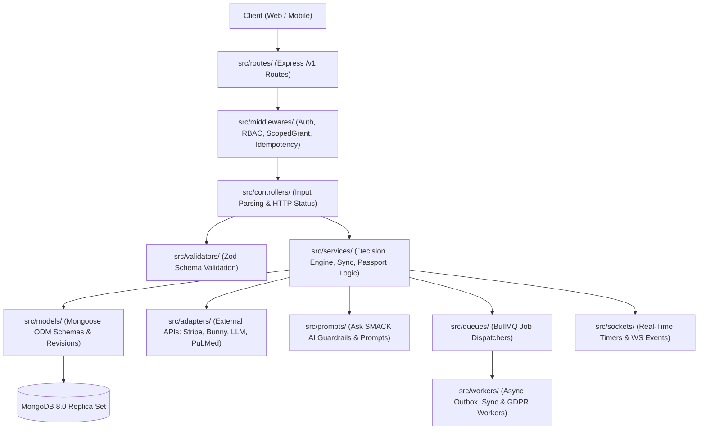

# SMACKGYM — System Architecture & Repository Blueprint (`Architecture.md`)

> **Master Repository Specification:** Aligned with **SMACKGYM Developer Handover v5.1 (Approved UX Revision — Daily Home v4)**, `docs/PRD.md`, `docs/HLD.md`, `docs/LLD.md`, and `docs/rules.md`.

---

## 1. Documentation & Specification Architecture

All product, architectural, engineering, and UX specifications are organized into canonical directories to provide a unified single source of truth across product owners, frontend/mobile engineers, and backend teams:

| Specification File | Document Type | Scope & Authority |
| :--- | :--- | :--- |
| **[`docs/PRD.md`](file:///home/bishal/BishalHome/Cours/Ecommarce/SMACKGYM/docs/PRD.md)** | **Product Requirements Document** | Defines *what* is built: UK `18+` university pilot, `Personal` vs. `Professional` modes, `Daily Home v4` UX rules, Super Admin Command Centre, milestone phases (`M0–M6`), and 16 staging QA release gates (`T01–T16`). |
| **[`docs/HLD.md`](file:///home/bishal/BishalHome/Cours/Ecommarce/SMACKGYM/docs/HLD.md)** | **High-Level Design** | Defines *how systems connect*: Cloud topology in UK `eu-west-2`, capacity estimates ($50\text{k}$ DAU / $250\text{k}$ MAU), Bunny/Cloudflare HLS video streaming offload, `MMKV`-to-MongoDB offline sync, and UK GDPR data isolation firewalls. |
| **[`docs/LLD.md`](file:///home/bishal/BishalHome/Cours/Ecommarce/SMACKGYM/docs/LLD.md)** | **Low-Level Design** | Defines *code-level internals*: Mongoose MongoDB schemas, compound indexes, optimistic `revision` concurrency control, deterministic 6-step Decision Engine rules, and `ScopedGrant` security middleware. |
| **[`docs/design.md`](file:///home/bishal/BishalHome/Cours/Ecommarce/SMACKGYM/docs/design.md)** | **Design System & UX Tokens** | Visual authority: 80–85% White/Off-White canvas (`#FFFFFF` / `#F6F7F3`), Electric Lime (`#C7FF00`) action triggers, `Anton` display headlines, `Inter` body/UI copy, and WCAG 2.2 AA accessibility standards. |
| **[`docs/rules.md`](file:///home/bishal/BishalHome/Cours/Ecommarce/SMACKGYM/docs/rules.md)** | **Engineering & Safety Rules** | Strict repository invariants: 100% TypeScript, Zero-SQL mandate, non-bypassable `Something hurts` safety holds, and LLM guardrails with $10\text{s}$ timeouts. |
| **[`server/docs/prd.md`](file:///home/bishal/BishalHome/Cours/Ecommarce/SMACKGYM/server/docs/prd.md)** | **Server PRD** | Backend service boundary, user roles (Athlete, Coach, Super Admin), 10 backend subsystems, and NFR performance budgets ($<100\text{ms}$ batch sync). |
| **[`server/docs/rules.md`](file:///home/bishal/BishalHome/Cours/Ecommarce/SMACKGYM/server/docs/rules.md)** | **Server Rules & Invariants** | Backend engineering rules: Zero-SQL MongoDB/Redis, optimistic concurrency (`revision`), UK GDPR Article 9 firewall, SSRF protection, and RFC 7807 errors. |
| **[`server/docs/phases.md`](file:///home/bishal/BishalHome/Cours/Ecommarce/SMACKGYM/server/docs/phases.md)** | **Server Phased Rollout** | Phased release register across P0 to P4, mapping backend capabilities directly to acceptance gates T01 through T16. |
| **[`UI/README.md`](file:///home/bishal/BishalHome/Cours/Ecommarce/SMACKGYM/UI/README.md)** | **Wireframe & UI Master Index** | Navigation shells, user flow state machines, desktop/mobile screen wireframes, 9 mandatory component states, and 4 visual blueprint boards. |

---

## 2. Complete Monorepo Folder Architecture (Zero-SQL / 100% TypeScript)

SMACKGYM is structured as a **TypeScript Monorepo** powered by Turborepo, sharing schemas, domain types, and API slices across Web, Mobile, and Backend with zero SQL dependencies:

```text
smackgym-ecosystem/
├── docs/                                    # Centralized Engineering & Product Docs
│   ├── PRD.md                               # Product Requirements Document (v5.1 Baseline)
│   ├── HLD.md                               # High-Level System Architecture & Cloud Topology
│   ├── LLD.md                               # Low-Level Database Schemas, Decision Engine & Concurrency
│   ├── design.md                            # Design System Tokens (#C7FF00, #101212, Anton, Inter)
│   ├── rules.md                             # Master Engineering, Safety & Zero-SQL Invariants
│   └── API_SPEC.yaml                        # OpenAPI v1 REST Contracts
│
├── UI/                                      # Master UI/UX & Wireframe Specifications
│   ├── README.md                            # UI Master Index & Design System Token Reference
│   ├── 01_USER_FLOWS_AND_ROLES.md           # End-to-End User Journeys & Role Permissions Matrix
│   ├── 02_WEBSITE_WIREFRAMES.md             # Desktop/Tablet Responsive Web Wireframes (SCR-ATH to SCR-ADM)
│   ├── 03_MOBILE_APP_WIREFRAMES.md          # Companion Mobile App Wireframes (Android & iOS Expo Router)
│   ├── 04_INTERACTIVE_STATES_AND_EDGE_CASES.md # Specifications for All 9 Mandatory Component States
│   ├── SMACKGYM_Desktop_Web_App_Wireframe.png  # Hi-Res Blueprint: Personal Athlete Desktop (/home)
│   ├── SMACKGYM_Mobile_App_Wireframe.png       # Hi-Res Blueprint: Personal Athlete Mobile (Android & iOS)
│   ├── SMACKGYM_Coach_Professional_Mode_Wireframe.png # Hi-Res Blueprint: Coach & Mentor Workspace
│   └── SMACKGYM_Admin_Command_Centre_Wireframe.png    # Hi-Res Blueprint: Operations & Safety Kill Switches
│
├── apps/
│   ├── web/                                 # React 19 + TypeScript + Tailwind CSS v4 (User Web + Admin)
│   │   ├── public/                          # Static fonts (Anton, Inter), manifest & brand icons
│   │   ├── src/
│   │   │   ├── app/                         # App root, router configuration & global providers
│   │   │   ├── layouts/                     # 3-Zone Desktop sidebar shell, Public layout & Admin RBAC shell
│   │   │   ├── features/                    # Domain-driven feature modules (No loose pages)
│   │   │   │   ├── auth/                    # Login, 18+ age gate & GDPR consent flows
│   │   │   │   ├── daily-home/              # Approved Daily Home v4 (5 circles, Next Move, Feed)
│   │   │   │   ├── workout-player/          # iFIT-style split video player, timers & pain safety hold
│   │   │   │   ├── passport/                # Performance Passport & user memory fact controls
│   │   │   │   ├── food-recovery/           # Manual Food Intelligence log & recovery check-ins
│   │   │   │   ├── discover-learn/          # Vertical video feed, universal search & research cards
│   │   │   │   ├── progress/                # Adherence metrics, PBs, Safe Streaks & Share cards
│   │   │   │   ├── coach-workspace/         # Professional Mode (Course builder & ScopedGrants)
│   │   │   │   └── admin-command-centre/    # Super Admin Command Centre (CMS, Moderation & Kill Switches)
│   │   │   ├── components/                  # Reusable accessible UI primitives (WCAG 2.2 AA)
│   │   │   ├── hooks/                       # Custom React hooks (offline status, media playback tokens)
│   │   │   ├── services/                    # Web API client & HLS streaming adapters
│   │   │   └── styles/                      # Tailwind CSS v4 theme & brand design tokens
│   │   ├── package.json
│   │   ├── tsconfig.json
│   │   ├── vite.config.ts
│   │   ├── tailwind.config.ts
│   │   └── .env.example
│   │
│   └── mobile/                              # React Native (Expo SDK 58) + NativeWind v4 (Android & iOS)
│       ├── assets/                          # App icons, splash screens & bundled offline fonts
│       ├── app/                             # Expo Router file-based navigation routes
│       │   ├── (auth)/                      # Onboarding, OAuth & 18+ verification stack
│       │   ├── (tabs)/                      # 5 Bottom tabs: Home, Train, Discover, Progress, Profile
│       │   ├── workout/                     # Fullscreen follow-along player & substitution modal routes
│       │   ├── coach/                       # Professional Mode mobile workspace routes
│       │   └── modals/                      # Adapt diff preview, Why this?, & Pain safety modals
│       ├── src/
│       │   ├── features/                    # Mobile-specific UI views & native gesture handlers
│       │   ├── storage/                     # Encrypted react-native-mmkv NoSQL queue & 7-day lease cache
│       │   ├── components/                  # NativeWind UI components & Lottie/3D canvas wrappers
│       │   └── services/                    # Background sync manager, push notifications & in-app pay
│       ├── package.json
│       ├── tsconfig.json
│       ├── app.json                         # Expo native permissions & deep-link schemes
│       ├── eas.json                         # EAS Cloud Build profiles (Android AAB & Apple IPA from Linux)
│       ├── metro.config.js
│       ├── tailwind.config.ts
│       └── .env.example
│
├── packages/
│   └── shared/                              # 90%+ Shared Business Logic Across Web, Mobile & Server
│       ├── src/
│       │   ├── types/                       # Canonical TypeScript interfaces (Passport, Twin, Plan, Grant)
│       │   ├── schemas/                     # Shared Zod validation schemas for forms & API payloads
│       │   ├── store/                       # Redux Toolkit slices & RTK Query API endpoints
│       │   ├── constants/                   # Locked colors (#C7FF00, #101212), enums & reason codes
│       │   └── locales/                     # Translation JSON packs (en-GB, bn, hi, ur, ar)
│       ├── package.json
│       └── tsconfig.json
│
├── server/                                  # Node.js 26 LTS + Express.js + TypeScript + MongoDB (Layered Architecture)
│   ├── bin/                                 # CLI binaries & initial database seed scripts
│   ├── docs/                                # Dedicated Server Engineering & Governance Specifications
│   │   ├── prd.md                           # Backend Product Requirements Document (Subsystems, Roles, NFRs)
│   │   ├── rules.md                         # Backend Engineering, Safety, NoSQL & Concurrency Invariants
│   │   └── phases.md                        # Phased Delivery Roadmap (P0–P4) & Acceptance Gates (T01–T16)
│   ├── logs/                                # Local application logs (git-ignored)
│   ├── nginx/                               # Local reverse proxy & SSL termination config
│   ├── public/                              # Public static assets & API health check endpoint
│   ├── scripts/                             # DB migration, backup & staging seed scripts
│   ├── uploads/                             # Quarantine temporary upload directory
│   │
│   ├── src/
│   │   ├── app.ts                           # Express application factory, security headers & global middlewares
│   │   ├── server.ts                        # HTTP server bootstrap, MongoDB connection & graceful exit
│   │   │
│   │   ├── adapters/                        # External 3rd-Party Integrations (Bunny HLS, Stripe UK, LLM, PubMed)
│   │   ├── config/                          # Environment (Zod), Database (Mongoose replica set), Redis setup
│   │   ├── controllers/                     # Express route controllers (auth, workout, passport, coach, admin)
│   │   ├── middlewares/                     # JWT Auth, RBAC, ScopedGrant ACL, Idempotency, Rate-Limit, ErrorHandler
│   │   ├── models/                          # Mongoose ODM schemas (Account, PlanVersion, SessionEvent, Fact, Grant)
│   │   ├── prompts/                         # Ask SMACK AI system prompts, safety guardrails & token caps
│   │   ├── queues/                          # BullMQ job queue definitions (session-sync, outbox, rights-expiry)
│   │   ├── routes/                          # Central /v1 API route mounting & URL definitions
│   │   ├── scripts/                         # Internal runtime maintenance scripts
│   │   ├── services/                        # Core domain business logic (decisionEngine, sessionSync, passport)
│   │   ├── sockets/                         # WebSocket real-time workout timer & notification handlers
│   │   ├── utils/                           # Structured logger, crypto helpers, domain errors, transaction
│   │   ├── validators/                      # Zod request validation schemas
│   │   └── workers/                         # BullMQ async background worker processors
│   │
│   ├── tests/                               # Automated Staging Verification Suites (T01–T16)
│   │   ├── unit/                            # Pure domain entity & decision engine rule tests
│   │   ├── integration/                     # Express routes, Mongoose queries & Redis lock tests
│   │   └── e2e/                             # Full personal loop & offline sync staging tests
│   │
│   ├── .dockerignore
│   ├── .env
│   ├── .env.example
│   ├── .env.production
│   ├── .gitignore
│   ├── Dockerfile
│   ├── package.json
│   └── tsconfig.json
│
├── package.json                             # Root workspace scripts (dev, build, lint, test)
├── turbo.json                               # Monorepo build pipeline & task caching rules
├── tsconfig.base.json                       # Shared strict TypeScript compiler configuration
├── docker-compose.yml                       # Local MongoDB replica set, Redis & Express containers
├── .gitignore
├── .env.example
├── TECH_STACK_AND_LANGUAGES.md
└── Architecture.md
```

---

## 3. High-Level System Architecture Summary

The complete high-level design is codified in **[`docs/HLD.md`](file:///home/bishal/BishalHome/Cours/Ecommarce/SMACKGYM/docs/HLD.md)**.

### 3.1 Cloud Topology & Data Flow

```text
+-----------------------------------+       +-----------------------------------+
|      Web App & Admin Centre       |       |    Android & Apple iOS Apps       |
|  (React 19 + TS + Tailwind v4)    |       | (React Native Expo + NativeWind)  |
+-----------------+-----------------+       +-----------------+-----------------+
                  |                                           |
                  | HTTPS / REST JSON                         | HTTPS + Encrypted MMKV Offline Queue
                  +---------------------+---------------------+
                                        |
                                        v
+-------------------------------------------------------------------------------+
|                     Express.js Modular Monolith API (`/v1`)                   |
|  [Auth & 18+ Gate] -> [RBAC & ScopedGrant ACL] -> [Idempotency & Rate Limit]  |
+-------+-------------------+-------------------+-------------------+-----------+
        |                   |                   |                   |
        v                   v                   v                   v
+---------------+   +---------------+   +---------------+   +-------------------+
|   MongoDB     |   | Redis/BullMQ  |   | Media CDN     |   | External Adapters |
| (Primary Data |   | (Outbox Jobs, |   | (Bunny/CF HLS |   | (Stripe UK GBP,   |
|  & Revisions) |   |  Rate Limits) |   | Signed Tokens)|   |  LLM, PubMed/RSS) |
+---------------+   +---------------+   +---------------+   +-------------------+
```

### 3.2 Core Architectural Principles
1. **Clean Layered Architecture First (`ARC-01`):** The backend follows a high-velocity Layer-by-Type structure in `/server/src/` (`controllers`, `services`, `models`, `middlewares`, `adapters`, `queues`, `workers`, `validators`). Cross-domain mutations execute via domain service contracts or the asynchronous **Transactional Outbox Pattern** (BullMQ/Redis).
2. **Offline-First Gym Reliability (`OFF-01` to `OFF-04`):** Completed sets write to `react-native-mmkv` in $< 100\text{ms}$ with client-generated RFC 4122 UUIDs. Batches flush idempotently via `POST /v1/session-events/batch` with duplicate suppression.
3. **Data Sovereignty & `ScopedGrant` Firewall:** Athletes own their personal records. Coach workspaces query athlete data through a server-side projection layer that strips special-category fields (`Religion/Fasting`, `Cycle/Reproductive`, `Pregnancy`, `Raw AI Chat`) by default.
4. **Media Streaming Offload:** Video demonstrations are served via signed HLS `.m3u8` tokens through Bunny Stream / Cloudflare CDN edge nodes, offloading 100% of video bandwidth from core servers.

---

## 4. Low-Level System Design & Engine Logic Summary

The complete low-level design is codified in **[`docs/LLD.md`](file:///home/bishal/BishalHome/Cours/Ecommarce/SMACKGYM/docs/LLD.md)**.

### 4.1 Key Implementation Invariants
1. **Optimistic Concurrency Control (`revision`):** Every mutable document (`PlanVersion`, `PassportFact`, `FoodEntry`) tracks an integer `revision`. Mutation requests require `expected_revision`; mismatches return `409 stale_revision` to prevent multi-device race conditions.
2. **Deterministic Decision Engine Pipeline:**
   $$\text{TwinSnapshot} + \text{Constraints} \xrightarrow{\text{6 Priority Steps}} \text{Recommendation Diff}$$
   * **Priority Order:** `1. Safety/Pain Holds` $\rightarrow$ `2. Consent & 18+ Gate` $\rightarrow$ `3. Time/Equipment Constraints` $\rightarrow$ `4. Periodisation & Deload` $\rightarrow$ `5. Primary Goals` $\rightarrow$ `6. Preferences`.
   * **LLM Role:** `Ask SMACK AI` only formats natural-language explanations around the pre-validated output. A $10\text{s}$ timeout triggers transparent fallback to deterministic rule text.
3. **Non-Bypassable Injury Safety Holds (`Something hurts`):** Reporting sharp pain mid-workout immediately freezes timers, adds an active hold to the Passport, and restricts loading. It cannot be overridden by AI chat or coach proposals.
4. **Rights & Kill-Switch Enforcement:** HLS playback tokens expire after 15 minutes. Triggering an Admin Kill Switch or license takedown invalidates CDN tokens in real time via Redis pub/sub.

---

## 5. Server Layered Architecture & Subsystems (`server/`)

To balance enterprise robustness with fast developer velocity, the backend organizes code into a high-productivity **Layer-by-Type (Clean Layered)** architecture. This eliminates 60+ nested subdirectories while cleanly separating HTTP handling, domain services, Mongoose schemas, AI prompt templates, and background job workers.

### 5.1 Layer Responsibilities & Module Flow



### 5.2 Directory Breakdown & Architectural Roles

1. **`src/adapters/` (External Integration Boundaries):** Encapsulates external third-party SDKs and network clients (Stripe UK billing, Bunny Stream HLS token signer, OpenAI/Gemini LLM client, SSRF-safe PubMed/Crossref fetchers). Core services never make raw external HTTP calls directly.
2. **`src/config/` (Runtime Configuration):** Zod-validated environment variables (`env.ts`), MongoDB connection with replica-set support (`database.ts`), and Redis connection pool (`redis.ts`).
3. **`src/controllers/` (HTTP Presentation Layer):** Parses requests, extracts authenticated user sessions, delegates to domain services, and formats standard JSON responses.
4. **`src/middlewares/` (Security & Governance Pipeline):**
   - `auth.ts`: Verifies JWT and checks Redis session revocation list.
   - `rbac.ts`: Enforces role-based permissions (Athlete, Coach, and Super Admin).
   - `scopedGrant.ts`: Enforces athlete-approved data visibility and redacts UK GDPR Article 9 special category data (faith, cycle, pregnancy, raw chat) from coach queries.
   - `idempotency.ts`: Verifies `Idempotency-Key` headers on plan mutations to prevent double-commits.
   - `rateLimiter.ts`: Sliding-window distributed rate limiter backed by Redis.
   - `errorHandler.ts`: Converts unhandled exceptions and domain errors into RFC 7807 Problem Details JSON.
5. **`src/models/` (Data Modeling & Persistence):** Mongoose schemas with compound indexes, optimistic `revision` counters, and schema validations (`Account`, `PlanVersion`, `SessionEvent`, `PassportFact`, `ScopedGrant`, `FoodEntry`, etc.).
6. **`src/prompts/` (AI Prompt Engineering & Clinical Guardrails):** Isolated system prompts, few-shot examples, clinical red-flag detectors, and token budget allocations for `Ask SMACK AI`.
7. **`src/queues/` & `src/workers/` (Asynchronous Job Processing):**
   - `queues/`: Defines BullMQ queues (`session-sync-queue`, `outbox-queue`, `gdpr-erasure-queue`, `rights-expiry-queue`).
   - `workers/`: Background consumers processing batch workout set synchronization, outbox event publishing, and automated takedowns of expired video licenses.
8. **`src/routes/` (Routing Registry):** Organizes endpoint paths into modular route files (`auth.routes.ts`, `workout.routes.ts`, `passport.routes.ts`, `coach.routes.ts`, `admin.routes.ts`).
9. **`src/services/` (Core Business Logic & Rules Engine):** Implements the deterministic 6-step Performance Decision Engine (`decisionEngine.service.ts`), session synchronization (`sessionSync.service.ts`), and passport memory management.
10. **`src/sockets/` (Real-Time Communication):** Handles WebSocket connections for in-gym live rest timers, coach-athlete notifications, and live session pauses.
11. **`src/utils/` (Cross-Cutting Helpers):** Winston JSON logger with automated PII scrubbing, KMS envelope encryption for sensitive health fields, domain error hierarchies, and MongoDB transaction helpers.
12. **`src/validators/` (Request DTOs):** Reusable Zod schemas validating request payloads, path parameters, and query filters.

### 5.3 Request-Response Lifecycle & Middleware Pipeline

```text
Incoming HTTP Request (HTTPS / TLS 1.3)
   │
   ▼
[1] correlationIdMiddleware         ──> Injects unique UUIDv4 X-Correlation-ID for distributed tracing
   │
   ▼
[2] rateLimiterMiddleware            ──> Checks Redis sliding window (blocks DDoS / brute-force attempts)
   │
   ▼
[3] authMiddleware                   ──> Verifies JWT, extracts User ID, checks session revocation in Redis
   │
   ▼
[4] ageGateMiddleware                ──> Enforces 18+ eligibility invariant before executing coaching logic
   │
   ▼
[5] rbacMiddleware                   ──> Validates actor permissions (Athlete, Coach, Super Admin)
   │
   ▼
[6] scopedGrantMiddleware            ──> Enforces Athlete -> Coach ACL & strips Art 9 sensitive data projections
   │
   ▼
[7] idempotencyMiddleware            ──> Checks Idempotency-Key header for POST/PUT plan mutations
   │
   ▼
[8] validateRequest(ZodSchema)       ──> Validates and sanitizes request body, parameters, and query strings
   │
   ▼
[9] Controller & Service             ──> Executes core business logic & Decision Engine rules
   │
   ▼
[10] MongoSession Transaction        ──> Commits atomic document writes & Outbox events with revision checks
   │
   ▼
Outgoing HTTP Response (RFC 7807 JSON)
```

---

## 6. Mandatory Environment & Tooling Configuration

Before writing application code, initialize and verify these core configuration files:

* **`docker-compose.yml`:** Spins up a local single-node **MongoDB Replica Set** (required for multi-document ACID transactions on plan acceptance) and **Redis** (for BullMQ background jobs and rate limiting).
* **`eas.json`:** Configures Expo Application Services to build and sign **Android (`.aab`)** and **Apple iOS (`.ipa`)** production binaries from a Linux environment without local macOS hardware.
* **`packages/shared/package.json`:** Compiles and exports shared Zod schemas, domain interfaces, and Redux Toolkit slices to both `apps/web` and `apps/mobile`.
* **`server/.env.example`:** Defines mandatory environment secrets (`MONGODB_URI`, `REDIS_URL`, `JWT_SECRET`, `BUNNY_STREAM_SIGNING_KEY`, `STRIPE_SECRET_KEY`, `LLM_API_KEY`, `DAILY_AI_TOKEN_BUDGET`).
