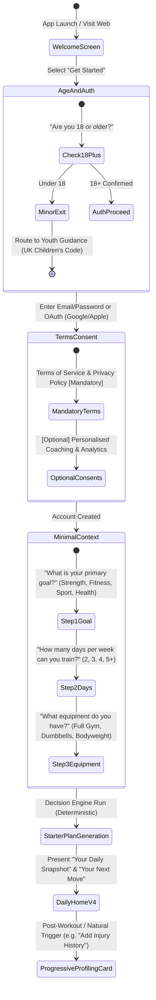
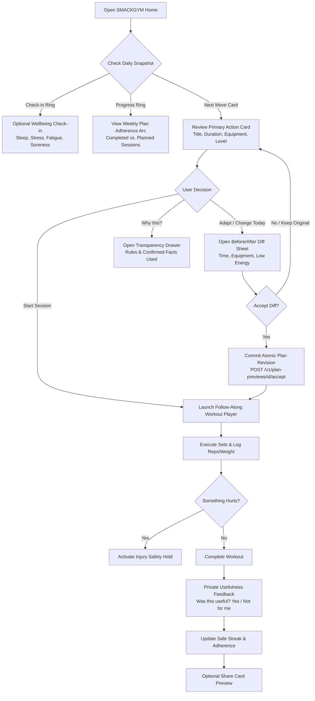
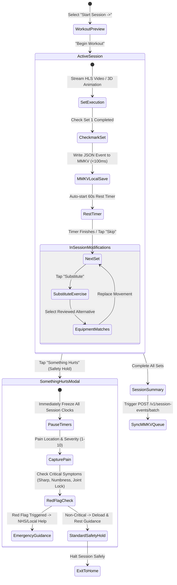
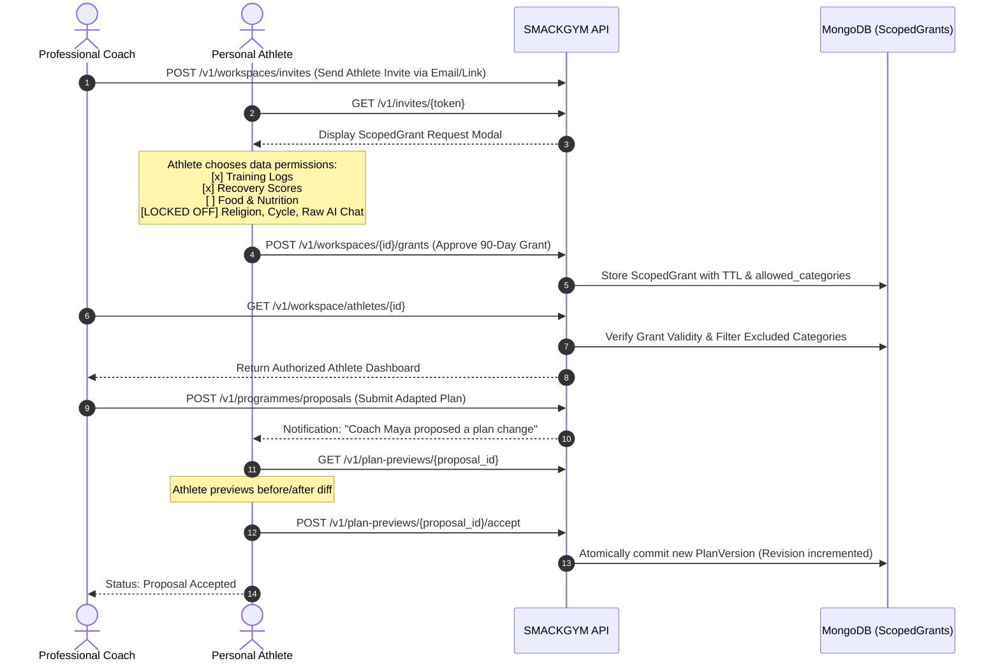
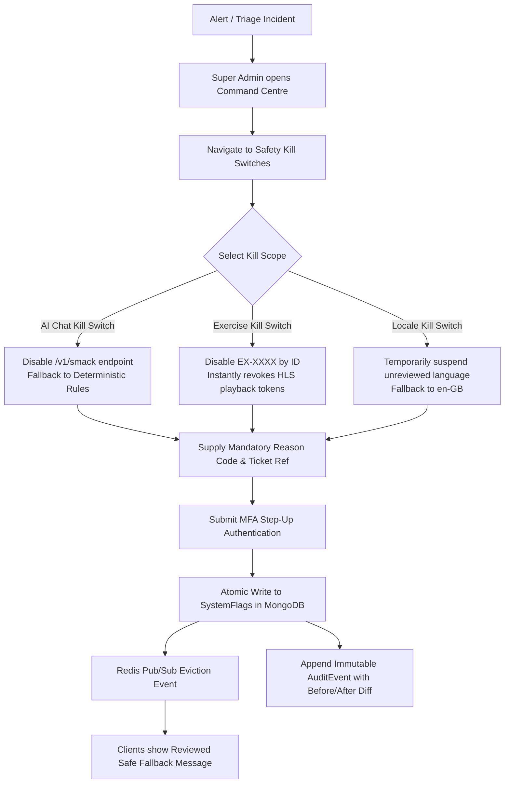

# SMACKGYM — Complete User Flows & Role Architecture (`01_USER_FLOWS_AND_ROLES.md`)

> **Authority:** Derived from `docs/PRD.md` (v5.1), `docs/design.md`, and **SMACKGYM Developer Handover v5.1** (Chapters 04, 05, 06, 08, 10, 13, 25, 34).

---

## 1. System Role Hierarchy & Permissions Matrix

SMACKGYM operates under a **"One Account, Two Modes"** architecture. Users authenticate once and switch modes based on verified entitlements and permissions.

```
+---------------------------------------------------------------------------------------------------------------+
|                                            SMACKGYM IDENTITY SYSTEM                                           |
|                                         (Unified 18+ Account Identity)                                        |
+-------------------------------------------------------+-------------------------------------------------------+
                                                        |
                            +---------------------------+---------------------------+
                            |                                                       |
                            v                                                       v
            +-------------------------------+                       +-------------------------------+
            |         PERSONAL MODE         |                       |       PROFESSIONAL MODE       |
            |   (100% Athlete Data Ownership)   |                       |    (Verified Coach / Mentor)   |
            +---------------+---------------+                       +---------------+---------------+
                            |                                                       |
                            |                                                       | ScopedGrant
                            +-------------------< Grant ACL >-----------------------+ (Athlete-Approved,
                            |                 (Time-Bound Access)                     Category-Restricted)
                            v
            +-------------------------------+
            |      PERFORMANCE PASSPORT     |
            | - Training Logs               |
            | - Food & Macro Logs           |
            | - Recovery Wellbeing Scores   |
            | [FIREWALL: Religion/Cycle/    |
            |  Pregnancy/Raw AI Chat BLOCKED|
            +-------------------------------+
```

### 1.1 Complete Role Matrix & Permission Boundaries

| Role Name | Platform | Core Permissions | Strictly Prohibited / Firewalled |
| :--- | :--- | :--- | :--- |
| **1. Personal User (Athlete)** | Web, Android, iOS | Owns Passport, edits memory facts, accepts/rejects plan adaptations, logs workouts & food, creates revocable `ScopedGrants`, exports/erases data under UK GDPR. | Accessing other users' private profiles or modifying unaccepted coach proposals directly into active schedules. |
| **2. Professional User (Coach/PT)** | Web, Android, iOS | Builds exercise variations, creates multi-week programmes, invites athletes, views granted client data, submits proposed plans. | Viewing unconsented athlete data; viewing religion, cycle, pregnancy, or raw AI chat; forcing plan changes without athlete acceptance. |
| **3. Team / Club Administrator** | Web Admin / Dashboard | Manages team rosters, invites students/club members, purchases seat licenses, views aggregate attendance/seat status. | **Zero visibility** into personal health data, private Passports, food logs, or individual workout performance. |
| **4. Super Administrator (`SUPER_ADMIN`)** | Web Command Centre | Full centralized administration: toggles system feature flags, triggers **Safety Kill Switches**, manages exercise and video rights, handles user moderation and disputes, oversees Stripe billing and entitlements, and audits immutable system logs. | Bypassing MFA for critical mutations or modifying system state without writing to the immutable audit log. |

---

## 2. End-to-End User Flow State Machines

### 2.1 Flow A: Personal User Onboarding & Progressive Profiling

This journey enforces the **"Fast Signup $\rightarrow$ Immediate Starter Value"** mandate. Users are never blocked behind an invasive 20-question intake form.



#### Progressive Fact Confirmation Flow:
1. Contextual prompt appears only when relevant to a specific user goal (e.g. adding dumbbells unlocks heavier strength options).
2. Displays transparent value proposition: *"Adding movement restrictions helps SMACKGYM filter out exercises that cause discomfort."*
3. Actions: **`Confirm Fact`**, **`Edit`**, or **`Snooze (7 days)`**.
4. Deleting any fact in `Performance Passport` immediately invalidates derived `TwinSnapshot` recommendations.

---

### 2.2 Flow B: The Daily Coaching Loop (`Daily Home v4`)

The signed-in daily cycle anchors the user experience.



---

### 2.3 Flow C: Follow-Along Workout Player & Injury Safety Hold

Governed by the **iFIT-style** execution paradigm and strict clinical safety invariants (`SAFE-01` to `SAFE-04`).



---

### 2.4 Flow D: Coach-Athlete Collaboration (`ScopedGrant` Protocol)

Ensures athlete data sovereignty: coaches cannot access private records without deliberate, revocable athlete consent.



---

### 2.5 Flow E: Admin Safety Kill Switch Execution

When an exercise, LLM anomaly, or copyright breach is identified, the Super Admin can instantly kill the feature across all mobile and web clients.



---

## 3. Screen Inventory by Role & Platform

```
====================================================================================================
SCREEN ID     SCREEN NAME                        PLATFORMS          PRIMARY ROLE / PURPOSE
====================================================================================================
SCR-ATH-01    Welcome & Value Intro              Web, Mobile        Unauthenticated Visitor
SCR-ATH-02    18+ Age Gate & Auth                Web, Mobile        New / Returning User
SCR-ATH-03    Minimal Context Intake             Web, Mobile        Onboarding Athlete
SCR-ATH-04    Signed-In Daily Home v4            Web, Mobile        Personal Athlete (Core Hub)
SCR-ATH-05    Why This? Transparency Drawer      Web, Mobile        Personal Athlete
SCR-ATH-06    Adapt (Change Today) Diff Sheet    Web, Mobile        Personal Athlete
SCR-ATH-07    Active Workout Follow-Along Player Web, Mobile        Personal Athlete (Execution)
SCR-ATH-08    Exercise Substitution Drawer       Web, Mobile        Personal Athlete (Execution)
SCR-ATH-09    Something Hurts Safety Sheet       Web, Mobile        Personal Athlete (Safety)
SCR-ATH-10    Session Summary & Feedback         Web, Mobile        Personal Athlete
SCR-ATH-11    Manual Food Intelligence Log       Web, Mobile        Personal Athlete (Fuel)
SCR-ATH-12    Recovery Wellbeing Check-In        Web, Mobile        Personal Athlete (Recovery)
SCR-ATH-13    Discover & Research Feed           Web, Mobile        Personal Athlete (Learn)
SCR-ATH-14    Universal Search & Results         Web, Mobile        Personal Athlete
SCR-ATH-15    Progress & Personal Bests (PBs)    Web, Mobile        Personal Athlete
SCR-ATH-16    Privacy-Safe Share Card Generator  Web, Mobile        Personal Athlete
SCR-ATH-17    Performance Passport Memory View   Web, Mobile        Personal Athlete (Data Control)
SCR-ATH-18    Privacy & ScopedGrant Manager      Web, Mobile        Personal Athlete (GDPR)
----------------------------------------------------------------------------------------------------
SCR-PRO-01    Coach Workspace Dashboard          Web, Mobile Tablet Professional Coach
SCR-PRO-02    Athlete Roster & Grant Status      Web, Mobile Tablet Professional Coach
SCR-PRO-03    Consented Athlete View             Web, Mobile Tablet Professional Coach
SCR-PRO-04    Programme & Course Builder         Web (Desktop)      Professional Coach
SCR-PRO-05    Plan Proposal Creator              Web (Desktop)      Professional Coach
----------------------------------------------------------------------------------------------------
SCR-INS-01    Team / University Dashboard        Web (Desktop)      Team / Club Administrator
SCR-INS-02    Roster & Seat Allocation           Web (Desktop)      Team / Club Administrator
----------------------------------------------------------------------------------------------------
SCR-ADM-01    Admin Command Centre Shell         Web (Desktop)      Super Admin
SCR-ADM-02    Operations & Kill Switches         Web (Desktop)      Super Admin
SCR-ADM-03    Content & Rights Catalogue         Web (Desktop)      Super Admin
SCR-ADM-04    Safety & Biomechanics Review       Web (Desktop)      Super Admin
SCR-ADM-05    Moderation & Triage Queue          Web (Desktop)      Super Admin
SCR-ADM-06    Billing & Entitlements Manager     Web (Desktop)      Super Admin
SCR-ADM-07    Support & System Audit Log         Web (Desktop)      Super Admin
====================================================================================================
```
