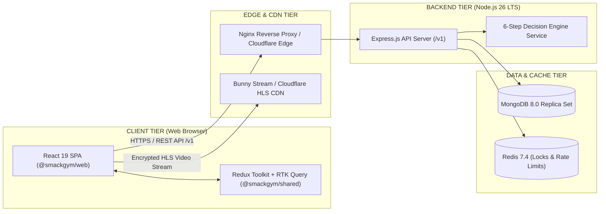
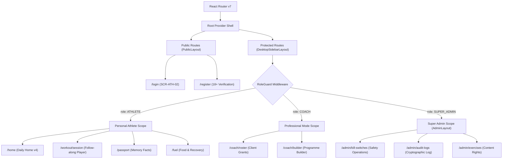
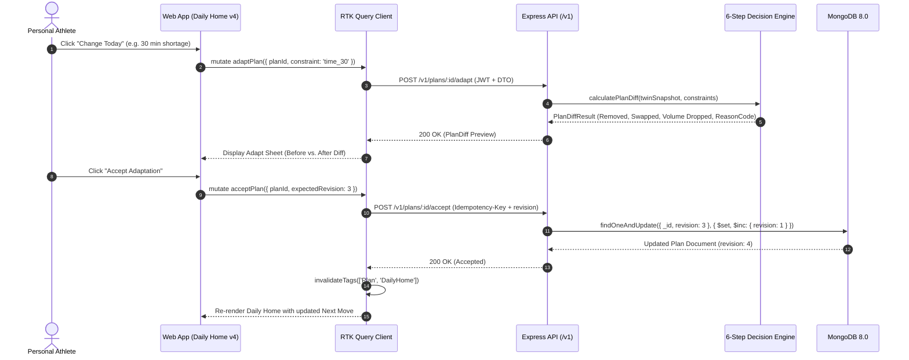
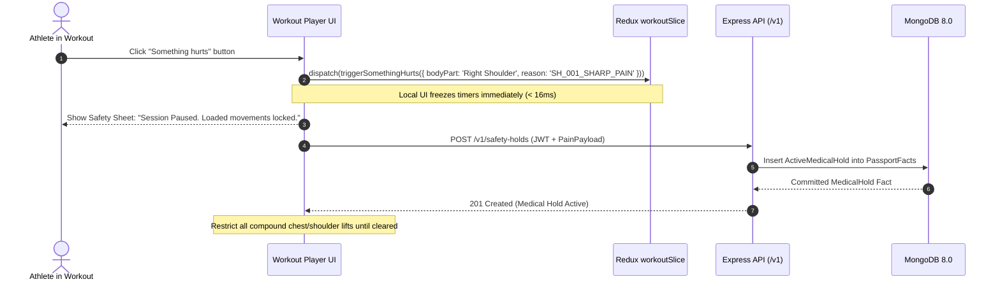
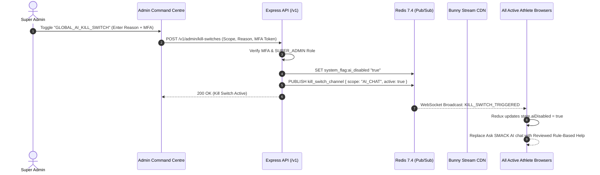

# SMACKGYM Web Application — System Architecture (`Architecture.md`)

> **Document Status:** Active Architectural Blueprint  
> **Target Scope:** `@smackgym/web` (Client Single-Page Application)  
> **Primary Stack:** React 19, TypeScript 5.8+, Vite 6, Tailwind CSS v4, Redux Toolkit & RTK Query (`@smackgym/shared`), React Router v7, Lucide React  
> **Alignment:** SMACKGYM Master Monorepo Specification, `docs/PRD.md` (Daily Home v4), `docs/design.md`, and `UI/02_WEBSITE_WIREFRAMES.md`

---

## 1. Bird's-Eye Overview

The SMACKGYM Web Application (`@smackgym/web`) is a high-performance, responsive Single-Page Application (SPA) serving three critical user roles: **Personal Athletes** (Daily Home v4, interactive workout follow-along player, Performance Passport), **Coaches & Mentors** (Professional Mode, course builder, athlete roster management), and the **Super Administrator** (Command Centre, real-time safety kill switches, content rights, and immutable audit logs).

Architecturally, the web app functions as an edge presentation client within a TypeScript monorepo. It delegates 90%+ of domain state machines, validation schemas, and API communication logic to `@smackgym/shared`, ensuring strict parity with the companion mobile app (`@smackgym/mobile`).

### High-Level System Topology



---

## 2. Repository Codemap

The `@smackgym/web` codebase follows a **Domain-Driven Feature Module** structure. No loose page components exist outside their respective feature boundaries:

```text
apps/web/
├── docs/                                    # Web-specific architecture & specifications
│   └── Architecture.md                      # This document
├── public/                                  # Static assets (brand icons, PWA manifest)
├── src/
│   ├── app/                                 # Root application setup & global providers
│   │   ├── App.tsx                          # Root router outlet, global modals & banners
│   │   ├── main.tsx                         # DOM root mount & Redux Provider initialization
│   │   └── routes.tsx                       # React Router v7 route definitions & guards
│   │
│   ├── layouts/                             # Structural page shells
│   │   ├── DesktopSidebarLayout.tsx         # 3-Zone Desktop Shell (Left Rail, Main Canvas, Right Context)
│   │   ├── PublicLayout.tsx                 # Header/footer shell for unauthenticated landing & auth
│   │   └── AdminLayout.tsx                  # High-density Command Centre layout with MFA badge
│   │
│   ├── features/                            # Domain-driven feature modules
│   │   ├── auth/                            # Login, 18+ age verification gate, GDPR consent capture
│   │   ├── daily-home/                      # Approved Daily Home v4 (5 Animated Circles, Next Move Card)
│   │   ├── workout-player/                  # Split video follow-along player, rest timers, Something Hurts
│   │   ├── passport/                        # Performance Passport view, memory fact inspector & eraser
│   │   ├── food-recovery/                   # Manual meal/macro logging (null-safe) & recovery check-ins
│   │   ├── discover-learn/                  # Vertical video feed, universal search, scientific research cards
│   │   ├── progress/                        # Adherence charts, Personal Bests (PBs), Safe Streaks, share cards
│   │   ├── coach-workspace/                 # Professional Mode (Athlete roster, Course & Programme Builder)
│   │   └── admin-command-centre/            # Super Admin: Real-time Kill Switches, CMS & Audit Trail
│   │
│   ├── components/                          # Reusable WCAG 2.2 AA accessible UI primitives
│   │   ├── ui/                              # Buttons, Modals, Drawers, Tooltips, Cards, Inputs, Badges
│   │   └── feedback/                        # Toast notifications, skeleton loaders, error boundaries
│   │
│   ├── hooks/                               # Custom React web hooks
│   │   ├── useAuthSession.ts                # Session state, 18+ check, and role guards
│   │   ├── useNetworkStatus.ts              # Online/offline detector with reconnection toasts
│   │   └── useHlsPlayer.ts                  # Hls.js video player wrapper with signed token attachment
│   │
│   ├── services/                            # Web-specific network clients & video streaming
│   │   └── hlsStream.service.ts             # Bunny Stream token resolver and manifest loader
│   │
│   └── styles/                              # Design system tokens & Tailwind CSS v4 styles
│       └── index.css                        # CSS reset, Anton & Inter font declarations, utility classes
│
├── index.html                               # HTML5 entry shell with Google Fonts preconnect
├── package.json                             # Dependencies (@smackgym/shared, React 19, Vite, Tailwind v4)
├── tsconfig.json                            # Strict TypeScript 5.8+ compiler options
└── vite.config.ts                           # Vite 6 bundler config with @tailwindcss/vite plugin
```

### Module Boundary Dependency Matrix

| Directory | Core Responsibility | Permitted Dependencies | Forbidden Dependencies |
| :--- | :--- | :--- | :--- |
| `src/app/` | Root mount, provider hierarchy, routing table | `layouts/`, `features/`, `@smackgym/shared` | Raw Mongoose models, server configs |
| `src/layouts/` | Structural shells (Sidebar, Navbars, Drawers) | `components/ui/`, `hooks/`, `@smackgym/shared` | Feature-specific business services |
| `src/features/*/` | Domain UI views, local state, form handling | `components/`, `hooks/`, `@smackgym/shared` | Sibling feature internals (use events/store) |
| `src/components/ui/` | Pure accessible UI primitives | React, Lucide Icons, Tailwind CSS | Redux store, feature hooks, API clients |
| `src/hooks/` | Reusable web-level hooks | React, Web APIs (Window, LocalStorage, Hls) | Feature page views, UI components |
| `packages/shared/` | Shared Redux slices, RTK Query, Zod schemas | `@reduxjs/toolkit`, `zod` | Browser DOM, React components, Node.js APIs |

---

## 3. Core Frontend Architecture & Boundaries

### 3.1 Routing & Role-Based Access Control (RBAC)

The routing engine uses **React Router v7** with declarative, nested route configurations and code-split dynamic imports (`React.lazy`):



#### Route Guard Invariants:
1. **Unauthenticated Redirect:** Any request to protected routes without a valid JWT in Redux `auth.accessToken` redirects to `/login` with an `?intended=/path` query param.
2. **18+ Verification Guard:** Users whose `auth.user.is18Plus !== true` are blocked from `/home` and `/workout/*` and redirected to an underage notice view.
3. **Super Admin Guard:** Access to `/admin/*` requires `auth.user.role === 'SUPER_ADMIN'` and an active MFA verification badge.

### 3.2 State Management Architecture

SMACKGYM separates client state cleanly into three distinct tiers:

```text
┌─────────────────────────────────────────────────────────────────────────────┐
│ 1. Server Cache State (RTK Query in @smackgym/shared/baseApi)               │
│    - Endpoints: getDailyHome, getActivePlan, getExerciseById, getPassport   │
│    - Cache Management: Tag-based automatic invalidation ('Plan', 'Workout') │
│    - Optimistic Updates: Instant UI feedback on set completion & meal log  │
├─────────────────────────────────────────────────────────────────────────────┤
│ 2. Global Client State (Redux Toolkit Slices in @smackgym/shared/store)     │
│    - authSlice: JWT tokens, user profile, active role, 18+ verification     │
│    - workoutSlice: Active session ID, exercise index, rest timer, pain hold │
│    - dailyHomeSlice: 5 ring values, nextMove, selected ring drawer state    │
│    - offlineSyncSlice: Pending MMKV/IndexedDB queue counter, online status  │
├─────────────────────────────────────────────────────────────────────────────┤
│ 3. Local Ephemeral UI State (React useState / useReducer)                   │
│    - Form field inputs, modal open/close, hover tooltips, video volume      │
└─────────────────────────────────────────────────────────────────────────────┘
```

### 3.3 Design System & UI Tokens

The UI strictly adheres to **[`docs/design.md`](file:///home/bishal/BishalHome/Cours/Ecommarce/SMACKGYM/docs/design.md)**:

* **Canvas Ratio:** 80–85% Dark Canvas (`#101212` background, `#1A1D1D` card surfaces, `#222626` borders).
* **Action Accent:** Electric Lime (`#C7FF00`) exclusively reserved for active buttons, completed rings, and primary interactive triggers. Never used for decorative body text.
* **Safety Alert:** Red (`#FF4B4B`) strictly reserved for pain triggers, active medical holds, and emergency kill switches.
* **Typography:**
  - Headlines & Numbers: **`Anton`** (Uppercase, condensed display font with letter-spacing `0.05em`).
  - Body, UI & Form Labels: **`Inter`** (Clean, legible sans-serif across 400, 500, 600, and 700 weights).
* **Accessibility (WCAG 2.2 AA):** All `#C7FF00` buttons render high-contrast black text (`#101212`) ensuring a contrast ratio $\ge 7:1$.

---

## 4. Critical Data & Request Flows

### 4.1 Daily Home v4 Plan Adaptation & Acceptance Flow

Athletes modify today's workout based on fatigue, time shortage, or equipment availability via the Change Today diff flow:



### 4.2 Non-Bypassable Pain Safety Hold Flow (`Something hurts`)

When an athlete experiences sharp pain during workout execution, safety holds immediately freeze the session:



### 4.3 Super Admin Real-Time Kill Switch Execution Flow

Super Admins can globally disable AI chat or emergency takedown unsafe exercise videos in real time:



---

## 5. Media & Video Streaming Architecture

Video demonstrations in SMACKGYM must stream reliably without degrading server performance:

```mermaid
flowchart LR
    Player["Workout Player Component (Hls.js)"]
    TokenAPI["Express API (/v1/content/:id/stream-token)"]
    BunnyEdge["Bunny Stream Edge CDN (.m3u8 / .ts)"]
    
    Player -->|1. Request Token| TokenAPI
    TokenAPI -->|2. Generate HMAC-SHA256 Token (15-min TTL)| Player
    Player -->|3. Fetch HLS Master Manifest with Token| BunnyEdge
    BunnyEdge -->|4. Deliver Adaptive Bitrate Chunks (1080p, 720p, 480p)| Player
```

* **Zero Direct Video Hosting:** No video files reside on the Express server or in the web app assets.
* **15-Minute Expiry:** Signed playback tokens expire after 15 minutes, preventing hotlinking.
* **Emergency Invalidation:** When the Super Admin triggers an exercise takedown, token signing keys are rotated or token hashes are blacklisted in Redis edge rules, immediately cutting off playing streams.

---

## 6. Security, Privacy & UK GDPR Governance

### 6.1 Authentication & Token Lifecycle
* **Access Tokens:** Short-lived JWTs (15-minute expiry) stored in Redux memory (`authSlice.accessToken`).
* **Refresh Tokens:** Long-lived rotating refresh tokens stored in secure `httpOnly`, `SameSite=Strict`, `Secure` cookies.
* **Silent Token Refresh:** When an API request returns `401 Unauthorized`, an RTK Query baseQuery mutex automatically halts outgoing requests, calls `/v1/auth/refresh`, updates the token, and replays the original request transparently.

### 6.2 UK GDPR Article 9 Special Category Isolation
* **Zero Client Leakage:** The web app never caches special category data (religious fasting calendars, menstrual cycle dates, pregnancy metrics) in unencrypted browser storage.
* **Coach View Redaction:** When a user with `COACH` role browses athlete profiles (`/coach/athletes/:id`), the API and client layout strictly omit all special category tabs unless an unexpired `ScopedGrant` document explicitly permits visibility.

---

## 7. Architectural Invariants (Non-Negotiable Rules)

1. **Strict Zero-SQL Client Architecture (`RULE-WEB-01`):**  
   The web application communicates exclusively with the Express REST API (`/v1`) using JSON payloads. It must never embed SQLite (e.g. sql.js), Prisma Client, or direct database connections.
2. **Deterministic-First AI Display (`RULE-WEB-02`):**  
   All workout adjustments and plan recommendations rendered in the UI are derived deterministically by the Decision Engine. Generative AI (`Ask SMACK AI`) operates strictly as an optional explanatory layer. If AI is offline, UI elements must render deterministic rule cards without disruption.
3. **Non-Bypassable Safety Holds (`RULE-WEB-03`):**  
   When `workout.isPainSafetyHoldActive === true`, the follow-along player must freeze timers and block the "Complete Set" button on loaded compound exercises. This state cannot be bypassed by navigating back or closing the modal.
4. **Zod Validation at Form Edge (`RULE-WEB-04`):**  
   Every user form (signup, login, food entry, coach proposal) must validate inputs against canonical Zod schemas from `@smackgym/shared/schemas` before dispatching any network mutation.
5. **No `any` Policy in TypeScript (`RULE-WEB-05`):**  
   `"strict": true` and `"noImplicitAny": true` are enforced. Component props, Redux action payloads, and API responses must map to typed interfaces from `@smackgym/shared/types`.

---

## 8. Development & Deployment Environments

### 8.1 Local Development Workflow

```bash
# 1. Start local MongoDB 8.0 & Redis 7.4 containers from repo root
docker compose up -d

# 2. Build shared core library
npm --prefix packages/shared run build

# 3. Start Express backend API server (runs on port 5000)
npm --prefix server run dev

# 4. Start Vite web development server (runs on port 3000)
npm --prefix apps/web run dev
```

### 8.2 Production Build & Topology

```bash
# Production static bundle generation
npm --prefix apps/web run build
```

* **Build Output:** Optimized static files emit to `apps/web/dist/`.
* **Hosting Targets:** Cloudflare Pages, Vercel, or static file serving behind Nginx reverse proxy.
* **Gzip/Brotli Compression:** Pre-compressed JS chunks ($\sim 119\text{ KB}$ gzipped) ensuring sub-second first paint over 4G connections.

### 8.3 Environment Variables Specification

Create `.env` in `apps/web/` based on this schema:

| Variable Name | Required | Purpose & Example Value |
| :--- | :--- | :--- |
| `VITE_API_URL` | **Yes** | Base URL for Express backend (`http://localhost:5000/v1` or `https://api.smackgym.com/v1`) |
| `VITE_HLS_CDN_URL` | **Yes** | Bunny Stream CDN hostname (`https://video.smackgym.com`) |
| `VITE_APP_ENV` | **Yes** | Current environment (`development`, `staging`, `production`) |
| `VITE_SENTRY_DSN` | No | Client error monitoring DSN (production only) |

---

## 9. Architectural Decision Records (ADRs)

| ADR ID | Architectural Decision | Context & Rationale | Trade-offs Accepted |
| :--- | :--- | :--- | :--- |
| **ADR-WEB-001** | **Vite SPA over Next.js SSR** | The web app requires high-frequency local client interactions (in-workout rest timers, 60fps SVG ring animations, local set logs). A client-side SPA eliminates server rendering overhead and allows seamless static CDN edge hosting. | Initial HTML bundle requires client-side JS execution; mitigated by aggressive code splitting and $< 120\text{KB}$ core bundle. |
| **ADR-WEB-002** | **Tailwind CSS v4 with Vite Plugin** | Modern utility-first CSS via `@tailwindcss/vite` provides zero-runtime performance, rapid UI authoring, and effortless token binding for brand colors (`#C7FF00`, `#101212`). | Learning curve for developers accustomed to traditional CSS modules; enforced through shared design tokens. |
| **ADR-WEB-003** | **Monorepo Shared Redux (`@smackgym/shared`)** | Sharing Redux Toolkit slices, RTK Query endpoints, and Zod schemas between Web and Mobile eliminates duplicate API integration code and ensures identical business logic across platforms. | Requires compiling `@smackgym/shared` before running web dev server; managed seamlessly via Turborepo task dependencies. |
| **ADR-WEB-004** | **3-Zone Desktop Sidebar Shell** | Fitness platforms require simultaneous visibility of active metrics (readiness), primary tasks (workout), and context (coach notes). The 3-zone desktop shell maximizes screen real estate on desktop and tablet. | Requires responsive collapsing to bottom tabs on smaller viewports; handled via media queries and layout adapters. |
