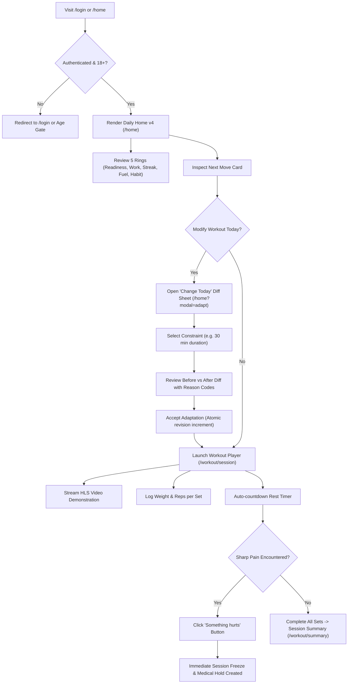
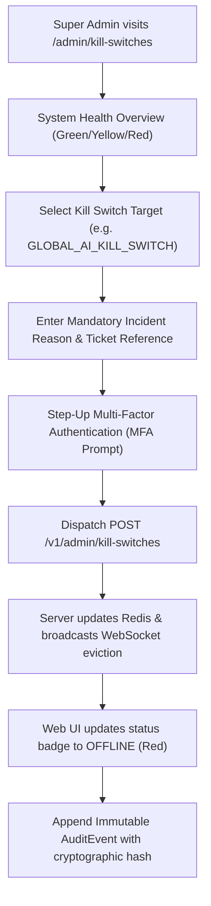
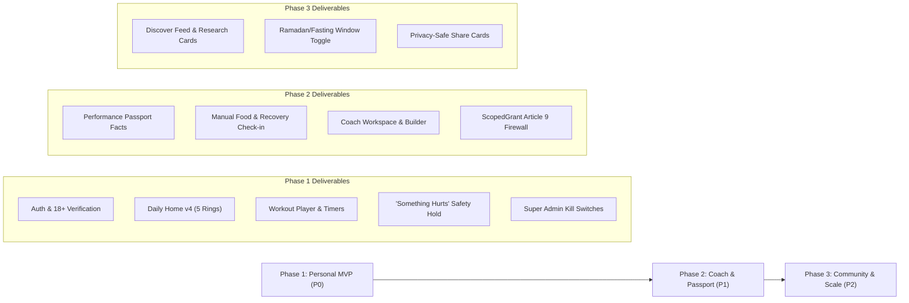

# SMACKGYM Web Application — Product Requirements Document (`PRD.md`)

> **Document Version:** 1.0.0  
> **Status:** Approved Engineering Specification  
> **Target Package:** `@smackgym/web` (Client Single-Page Application)  
> **Platform & Framework:** React 19, TypeScript 5.8+, Vite 6, Tailwind CSS v4, Redux Toolkit & RTK Query (`@smackgym/shared`), React Router v7  
> **Alignment:** SMACKGYM Master Monorepo Specification, `docs/PRD.md` (v5.1 Baseline), `docs/design.md`, `UI/01_USER_FLOWS_AND_ROLES.md`, and `UI/02_WEBSITE_WIREFRAMES.md`

---

## 1. Executive Summary & Problem Statement

### 1.1 Overview
The SMACKGYM Web Application (`@smackgym/web`) is the official responsive desktop and tablet browser client for the SMACKGYM fitness ecosystem. It delivers high-density, rich user interfaces for three core personas: **Personal Athletes** managing their daily training, nutrition, and recovery; **Professional Coaches** authoring multi-week periodized programs and supervising athlete rosters; and the **Super Administrator** operating platform-wide safety kill switches, content moderation, and audit compliance.

### 1.2 Problem Statement
Modern fitness applications are overwhelmingly mobile-first, forcing athletes and coaches into cramped 6-inch screens for complex tasks:
1. **Coaches & Trainers** struggle to design multi-week training periodization, adjust exercise volume, and review biomechanics on small mobile displays.
2. **Athletes** studying exercise execution cues, comparing before/after plan adaptation diffs, and auditing their personal health memory facts lack a spacious desktop overview.
3. **Operations & Clinical Safety Staff** cannot reliably execute emergency platform overrides (such as instant AI chat disablement or copyright takedowns) without a dedicated, high-security desktop Command Centre.

### 1.3 Proposed Solution
`@smackgym/web` provides a high-performance, accessible Single-Page Application built with **React 19**, **Tailwind CSS v4**, and **Turborepo Monorepo tooling**. By delegating 90%+ of state machines, validation logic, and API calls to `@smackgym/shared`, the web app guarantees 100% data and logic parity with the companion mobile app while delivering a 3-Zone Desktop layout optimized for large viewports.

---

## 2. Goals, Non-Goals & Success Metrics

### 2.1 Goals
* **G1 (Approved Daily Home v4):** Render the 5 animated readiness circles (Readiness, Weekly Work, Safe Streak, Food/Macros, Habit/Recovery) with instant sub-100ms drawer inspection.
* **G2 (Interactive Workout Follow-Along Player):** Deliver split-screen video playback via Bunny Stream HLS, set/rep logging, rest countdown timers, and the non-bypassable **`Something hurts`** safety freeze.
* **G3 (Professional Mode Course Builder):** Enable coaches to assemble, schedule, and assign multi-week training programs with drag-and-drop exercise selection.
* **G4 (Super Admin Command Centre):** Provide sub-100ms global safety kill switches (`GLOBAL_AI_KILL_SWITCH`, exercise video takedown) with mandatory MFA and cryptographic audit logging.
* **G5 (Design & Accessibility Excellence):** Achieve 100% WCAG 2.2 AA compliance ($\ge 7:1$ contrast ratio for `#C7FF00` on `#101212`) and sub-second page transitions.

### 2.2 Non-Goals (Explicitly Out of Scope for v1)
* **NG-01 (In-Gym Offline Queue):** High-velocity offline write queuing using `react-native-mmkv` is reserved for `@smackgym/mobile`. The web app requires an active network connection, displaying an informative offline banner if disconnected.
* **NG-02 (Direct Wearable Bluetooth Ingestion):** Live BLE heart rate strap pairing in browser (Web Bluetooth API) is excluded for v1; wearable biometric data syncs via mobile background services and the backend API.
* **NG-03 (Direct Video Transcoding on Web):** The web app never uploads raw 4K videos directly to the Express server; video uploads flow through pre-signed CDN ingestion pipelines.

### 2.3 Success Metrics (KPIs)

| Metric | Target SLA | Measurement Method |
| :--- | :--- | :--- |
| **Largest Contentful Paint (LCP)** | $< 2.0\text{s}$ over 4G / Desktop | Chrome UX Report / Lighthouse CI |
| **First Input Delay (FID) / INP** | $< 50\text{ms}$ | Web Vitals Telemetry |
| **18+ Verification Completion** | $< 60\text{s}$ from landing to `/home` | Analytics Funnel (`SCR-ATH-02`) |
| **Workout Completion Rate** | $\ge 82\%$ of initiated sessions | Session Event Telemetry (`/v1/session-events`) |
| **Safety Hold Response Latency** | $< 16\text{ms}$ (instant UI freeze) | Local Redux dispatch benchmark |
| **Core Bundle Size** | $< 150\text{ KB}$ (gzipped) | Vite build output audit |

---

## 3. Target Users & Permissions Matrix

The web application enforces strict Role-Based Access Control (RBAC) across three distinct authenticated roles and one guest state:

| Role Code | Persona | Primary Web Workspaces | Permitted Web Capabilities | Prohibited / Denied Actions |
| :--- | :--- | :--- | :--- | :--- |
| `GUEST` | **Unauthenticated Visitor** | Public Landing (`/`), Login (`/login`), 18+ Register (`/register`) | Browsing public curriculum overview, submitting age verification, authentication. | Accessing `/home`, workout player, or API endpoints requiring JWT. |
| `ATHLETE` | **Personal Athlete** (UK 18+ Student / Gym Goer) | Personal Portal (`/home`, `/workout/*`, `/passport`, `/fuel`, `/progress`) | Viewing Daily Home v4, logging workouts, triggering pain holds, editing memory facts, generating revocable `ScopedGrants`. | Accessing other athletes' data; viewing coach course builder or admin command centre. |
| `COACH` | **Coach / Mentor** (Professional Mode) | Professional Workspace (`/coach/roster`, `/coach/builder`, `/coach/proposals`) | Managing client rosters, authoring multi-week courses, submitting proposed plan adjustments. | Viewing unconsented athlete data; accessing Article 9 data (faith/cycle/pregnancy) without explicit grant; accessing Super Admin controls. |
| `SUPER_ADMIN` | **Super Administrator** | Command Centre (`/admin/kill-switches`, `/admin/exercises`, `/admin/audit`) | Triggering global kill switches, managing exercise rights, overriding subscriptions, inspecting immutable audit logs. | Bypassing MFA step-up verification; deleting audit log entries (append-only collection). |

---

## 4. Core User Flows

### 4.1 Flow 1: Personal Athlete Daily Home & Workout Execution



### 4.2 Flow 2: Super Admin Emergency Kill Switch Execution



---

## 5. Functional Requirements by Feature Tier

### Feature 1: Authentication, 18+ Age Gate & Consent — `[P0]`
* **User Story:** As an athlete, I want to verify my age and sign in securely so that I can access personalized training safely and legally under the UK Children's Code.
* **Functional Requirements:**
  1. Registration requires email, password (min 8 chars, 1 uppercase, 1 lowercase, 1 number), full name, and explicit checkbox confirmation that the user is $\ge 18$ years old.
  2. If the user indicates an age $< 18$, the system must block account creation with HTTP `403 forbidden_underage` and render a clear UK youth guidance screen.
  3. Authentication issues a 15-minute JWT stored in Redux memory (`authSlice`) and an `httpOnly`, `Secure` refresh cookie.
  4. Silent token refresh executes automatically in the background via RTK Query mutex when a `401 Unauthorized` is encountered.
* **Acceptance Criteria:**
  - [ ] **Given** valid registration inputs with `is18Plus: true`, **When** the user clicks "Create Account", **Then** the account is created, JWT tokens are stored, and the user is redirected to `/home`.
  - [ ] **Given** an unchecked 18+ box, **When** submitting the form, **Then** client validation blocks the submission and displays: *"You must be 18 years of age or older to use SMACKGYM"*.
* **Edge Cases & Error States:**
  - Network timeout during login $\rightarrow$ Display retry toast without clearing entered email.
  - Expired refresh token $\rightarrow$ Clear auth state and redirect to `/login?session_expired=true`.

---

### Feature 2: Daily Home v4 Core Hub — `[P0]`
* **User Story:** As an athlete, I want a single scannable screen showing my readiness and next workout so that I can take immediate training action without navigating complex menus.
* **Functional Requirements:**
  1. Render 5 interactive circular SVG rings matching `docs/design.md`:
     - **Ring 1 (Readiness Score):** 0–100 calculated from morning recovery check-in.
     - **Ring 2 (Weekly Work):** Completed sessions vs. weekly target (e.g., 3/5).
     - **Ring 3 (Safe Streak):** Consecutive training days without unsafe overload.
     - **Ring 4 (Fuel / Macros):** Protein & calorie progress against target.
     - **Ring 5 (Habit / Rest):** Sleep duration score and recovery index.
  2. Clicking any ring opens an informative slide-over drawer detailing the underlying metrics, historical trends, and physiological explanation.
  3. Prominently display the **Next Move Card** featuring workout title, estimated duration, equipment required, and a high-contrast `#C7FF00` "START WORKOUT" action button.
* **Acceptance Criteria:**
  - [ ] **Given** authenticated athlete on `/home`, **When** the page mounts, **Then** the 5 rings animate from 0 to their server-calculated values within $800\text{ms}$.
  - [ ] **Given** Next Move is available, **When** clicking "START WORKOUT", **Then** the app navigates immediately to `/workout/session`.
* **Edge Cases:**
  - No workout scheduled today $\rightarrow$ Next Move card displays "Rest & Active Recovery" with optional mobility routine.

---

### Feature 3: Interactive Workout Follow-Along Player — `[P0]`
* **User Story:** As an athlete in a workout, I want video demonstrations, set logging, and automatic rest timers so that I can execute my exercises with proper form and tempo.
* **Functional Requirements:**
  1. Split-screen layout: Top/Left pane renders HLS video demonstration via Bunny Stream CDN; Bottom/Right pane renders set logger and cues.
  2. Video player automatically attaches signed HMAC-SHA256 tokens (15-min TTL) requested from `/v1/content/:id/stream-token`.
  3. Each exercise displays setup cues, primary muscles worked, and an input table for Weight (kg) and Actual Reps.
  4. Clicking "Complete Set" saves the set, marks it green (`#22C55E`), and triggers the Rest Timer countdown with audible beep on completion.
* **Acceptance Criteria:**
  - [ ] **Given** an active workout set, **When** user enters 80kg, 10 reps and clicks "Complete Set", **Then** the set is marked completed in Redux `workoutSlice` and the rest timer starts.
  - [ ] **Given** video playback error, **When** HLS chunk fails to load, **Then** show retry button and fall back to static looping GIF preview.

---

### Feature 4: Non-Bypassable Pain Safety Hold (`Something hurts`) — `[P0]`
* **User Story:** As an athlete experiencing joint pain, I want to report pain immediately so that the system stops my workout and protects me from injury.
* **Functional Requirements:**
  1. A persistent, high-visibility "Something hurts" button (`#FF4B4B`) is pinned on the workout player at all times.
  2. Clicking the button immediately pauses all active rest timers ($< 16\text{ms}$ local Redux dispatch) and opens the Pain Triage Modal.
  3. Athlete selects affected body part (e.g. Left Shoulder) and pain type (Sharp pain, joint pinch, dull ache).
  4. Submitting dispatches `POST /v1/safety-holds`, records an active medical hold in the athlete's Passport, and restricts loaded movements for that muscle group.
  5. The workout player enters a locked state; timers cannot be restarted, and compound loaded sets are disabled until cleared by the athlete or medical resolution.
* **Acceptance Criteria:**
  - [ ] **Given** an athlete in an active bench press set, **When** clicking "Something hurts", **Then** timers freeze instantly and loaded pressing sets are locked.
  - [ ] **Given** an active medical hold, **When** athlete attempts to bypass by refreshing the browser, **Then** the session restores with the hold locked.

---

### Feature 5: Change Today (Plan Adaptation) Diff Sheet — `[P0]`
* **User Story:** As an athlete with unexpected gym constraints (e.g. busy gym, missing dumbbells), I want to adapt today's session so that I can still train effectively without breaking my program.
* **Functional Requirements:**
  1. Clicking "Change Today" on `/home` opens the Adaptation Diff Sheet.
  2. Athlete selects constraint: Time Shortage (20, 30, 45 min), Equipment Missing (No barbell, bodyweight only), or High Fatigue.
  3. Client calls `POST /v1/plans/:id/adapt` and renders a before-and-after diff highlighting added, removed, or substituted exercises with physiological reason codes.
  4. Clicking "Accept Adaptation" calls `POST /v1/plans/:id/accept` with `expected_revision` to prevent concurrent overwrite.
* **Acceptance Criteria:**
  - [ ] **Given** adaptation proposal, **When** accepted, **Then** the plan revision increments atomically, the drawer closes, and Daily Home reflects the new workout.

---

### Feature 6: Performance Passport & Fact Memory Controls — `[P1]`
* **User Story:** As a privacy-conscious athlete, I want full visibility and control over what the AI knows about me so that I retain complete data sovereignty under UK GDPR.
* **Functional Requirements:**
  1. `/passport` displays all active facts categorized into Equipment, Injuries, Preferences, Schedule, and Nutrition.
  2. Each fact displays its origin: `user_declared`, `session_derived`, or `coach_submitted`.
  3. Athletes can delete individual facts with instant confirmation, triggering immediate server-side cache purging.
  4. Single-click "Export My Data" button triggers UK GDPR Article 20 data portability JSON download.

---

### Feature 7: Manual Food Intelligence & Recovery Check-Ins — `[P1]`
* **User Story:** As an athlete, I want to log my meals and recovery status with minimal friction so that my readiness score accurately reflects my physiological state.
* **Functional Requirements:**
  1. Food entry form supports meal name and optional, null-safe fields for Calories, Protein (g), Carbs (g), Fat (g), and Hydration (ml).
  2. If Ramadan / Fasting mode is active, daytime hydration warnings are suppressed and calorie targets shift to the evening window.
  3. Recovery check-in captures 1–5 slider ratings for Sleep Quality, Muscle Soreness, Energy Level, and Stress Level, computing a 0–100 Readiness Index.

---

### Feature 8: Coach Professional Mode & Course Builder — `[P1]`
* **User Story:** As a certified personal trainer, I want a desktop workspace to build multi-week training programs and supervise my athletes without seeing their private health data.
* **Functional Requirements:**
  1. `/coach/builder` provides a high-density drag-and-drop course authoring canvas: weeks, workout days, exercise blocks, sets, reps, and target RPE.
  2. Athlete roster displays consented clients with active `ScopedGrant` badges.
  3. Coach views strictly redact UK GDPR Article 9 data (faith/fasting, menstrual cycle, pregnancy, raw AI chat) unless explicitly granted by the athlete.
  4. Coaches can draft plan adjustment proposals, which are sent to the athlete for explicit acceptance (coaches cannot force changes unilaterally).

---

### Feature 9: Super Admin Command Centre & Kill Switches — `[P0]`
* **User Story:** As a Super Administrator, I want a centralized control panel to trigger instant safety kill switches and monitor platform health.
* **Functional Requirements:**
  1. `/admin/kill-switches` displays real-time system status badges:
     - `GLOBAL_AI_KILL_SWITCH`: Instantly disables Ask SMACK AI chat endpoint, falling back 100% to reviewed deterministic rules.
     - `EXERCISE_PLAYBACK_TAKEDOWN`: Invalidates video streaming tokens for a specific exercise ID.
     - `NEW_REGISTRATIONS_PAUSED`: Halts new signups during incidents.
  2. Triggering any kill switch requires entering a mandatory reason code and passing step-up MFA.
  3. All actions append immutable entries to the cryptographic audit log view (`/admin/audit`).

---

### Feature 10: Discover Feed & Scientific Research Cards — `[P2]`
* **User Story:** As an athlete, I want access to peer-reviewed fitness evidence and exercise tutorials so that I understand the science behind my training.
* **Functional Requirements:**
  1. Vertical scroll feed displaying reviewed exercise technique videos and evidence-backed research cards harvested from PubMed and Crossref.
  2. Each card features DOI citation link, key takeaway summary, and direct links to related exercises in the SMACKGYM library.

---

## 6. Screen Inventory & UX Requirements

All screens adhere to the 9 mandatory UI component states specified in `UI/04_INTERACTIVE_STATES_AND_EDGE_CASES.md`:

```
====================================================================================================
SCREEN ID     SCREEN NAME                        ROUTE                     ROLE REQUIRED
====================================================================================================
SCR-ATH-01    Landing & Value Intro              /                         Guest
SCR-ATH-02    18+ Age Gate & Auth                /login, /register         Guest
SCR-ATH-03    Minimal Context Intake             /onboarding               Authenticated Athlete
SCR-ATH-04    Signed-In Daily Home v4            /home                     Personal Athlete
SCR-ATH-05    Why This? Transparency Drawer      /home?drawer=why-this     Personal Athlete
SCR-ATH-06    Adapt (Change Today) Diff Sheet    /home?modal=adapt         Personal Athlete
SCR-ATH-07    Active Workout Follow-Along Player /workout/session          Personal Athlete
SCR-ATH-08    Exercise Substitution Drawer       /workout/substitute       Personal Athlete
SCR-ATH-09    Something Hurts Safety Sheet       /workout/safety-hold      Personal Athlete
SCR-ATH-10    Session Summary & Feedback         /workout/summary          Personal Athlete
SCR-ATH-11    Manual Food Intelligence Log       /fuel                     Personal Athlete
SCR-ATH-12    Recovery Wellbeing Check-In        /recovery                 Personal Athlete
SCR-ATH-13    Discover & Research Feed           /learn                    Personal Athlete
SCR-ATH-14    Universal Search & Results         /search                   Personal Athlete
SCR-ATH-15    Progress & Personal Bests (PBs)    /progress                 Personal Athlete
SCR-ATH-16    Privacy-Safe Share Card Generator  /progress/share           Personal Athlete
SCR-ATH-17    Performance Passport Memory View   /passport                 Personal Athlete
SCR-ATH-18    Privacy & ScopedGrant Manager      /passport/privacy         Personal Athlete
----------------------------------------------------------------------------------------------------
SCR-PRO-01    Coach Workspace Dashboard          /coach                    Professional Coach
SCR-PRO-02    Athlete Roster & Grant Status      /coach/roster             Professional Coach
SCR-PRO-03    Consented Athlete View             /coach/athletes/:id       Professional Coach
SCR-PRO-04    Programme & Course Builder         /coach/builder            Professional Coach
SCR-PRO-05    Plan Proposal Creator              /coach/proposals/new      Professional Coach
----------------------------------------------------------------------------------------------------
SCR-ADM-01    Admin Command Centre Shell         /admin                    Super Admin (MFA)
SCR-ADM-02    Operations & Kill Switches         /admin/kill-switches      Super Admin (MFA)
SCR-ADM-03    Content & Rights Catalogue         /admin/exercises          Super Admin (MFA)
SCR-ADM-04    Safety & Biomechanics Review       /admin/safety-review      Super Admin (MFA)
SCR-ADM-05    Moderation & Triage Queue          /admin/moderation         Super Admin (MFA)
SCR-ADM-06    Billing & Entitlements Manager     /admin/billing            Super Admin (MFA)
SCR-ADM-07    Support & System Audit Log         /admin/audit              Super Admin (MFA)
====================================================================================================
```

---

## 7. Non-Functional Requirements (NFRs)

### 7.1 Performance & Web Vitals
* **Core Web Vitals Thresholds:**
  - Largest Contentful Paint (LCP) $\le 2.0\text{s}$
  - Cumulative Layout Shift (CLS) $\le 0.05$
  - Interaction to Next Paint (INP) $\le 100\text{ms}$
* **Build Budget:** Total initial JavaScript payload $< 150\text{ KB}$ gzipped. Code-split dynamic chunks loaded strictly on demand per route.

### 7.2 Browser & Device Responsiveness
* **Tier 1 Supported Browsers:** Chrome 120+, Safari 17+, Firefox 120+, Edge 120+.
* **Breakpoints (Tailwind CSS v4):**
  - Mobile: $< 640\text{px}$ (Collapses desktop sidebar to sticky bottom navigation bar).
  - Tablet: $768\text{px} - 1023\text{px}$ (Condensed 2-zone layout).
  - Desktop: $\ge 1024\text{px}$ (Full 3-zone layout with sidebar rail, central canvas, and context drawer).

### 7.3 Security & UK GDPR Invariants
* **Zero Hardcoded Secrets:** All runtime configuration resolved via `import.meta.env` with `VITE_` prefix.
* **XSS Prevention:** React JSX default escaping; zero usage of `dangerouslySetInnerHTML`.
* **Content Security Policy (CSP):** Strict CSP headers enforcing HTTPS video streaming from Bunny CDN and blocking unauthorized script injection.

---

## 8. Release Milestones & Phased Rollout



| Phase | Target Scope | Core Deliverables | Exit Criteria |
| :--- | :--- | :--- | :--- |
| **Phase 1 — MVP** | Core `P0` Features | Auth, 18+ Gate, Daily Home v4, Workout Player, Safety Hold, Admin Kill Switches | Successful end-to-end workout logging and verified pain freeze in $< 16\text{ms}$. |
| **Phase 2 — v1.1** | `P1` Features | Performance Passport, Food/Recovery Logging, Coach Workspace & Course Builder | Coach authors 4-week program; athlete reviews and accepts adaptation diff. |
| **Phase 3 — v2.0** | `P2` Features | Discover & Research Feed, Fasting calculator, Share Cards, Multi-language strings | Automated ingestion of PubMed research cards; 100% test coverage on staging gates. |

---

## 9. Risks, Dependencies & Mitigations

| Risk Description | Severity | Impact | Mitigation Strategy |
| :--- | :--- | :--- | :--- |
| **Video Playback Latency in Gyms** | High | Video stalls or fails to buffer over spotty gym Wi-Fi / 4G. | Implement HLS adaptive bitrate streaming (auto-drops to 480p) and pre-load fallback SVG animated movement loops. |
| **Underage User Access (Compliance)** | Critical | Violation of UK Age Appropriate Design Code (Children's Code). | Server-side invariant enforcement (`ageGateMiddleware`) blocking plan generation if birth date $< 18$; client cannot bypass via local storage tampering. |
| **Accidental State Loss on Refresh** | Medium | User refreshes browser mid-workout and loses set progress. | Workout session state and completed sets automatically persist to Redux store synchronized with session storage. |
| **Coach Overreach into Private Data** | High | Coach viewing sensitive health, fasting, or reproductive records. | Server-side projection firewall redacts Article 9 fields by default; client UI completely hides sensitive tabs unless unexpired `ScopedGrant` exists. |
