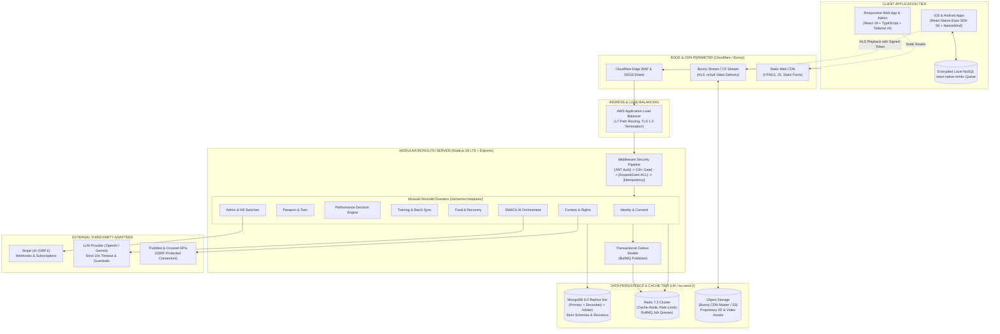
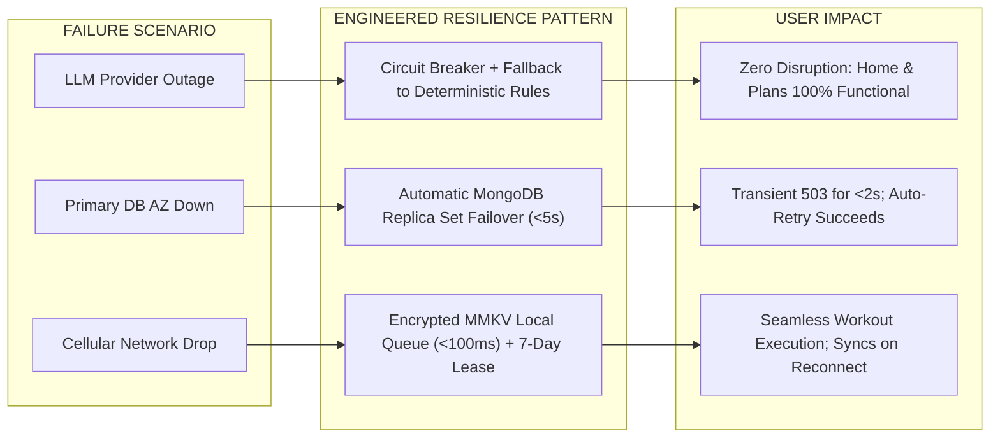

# SMACKGYM — High-Level System Design (HLD) Specification (`docs/HLD.md`)

| Document Metadata | Details |
| :--- | :--- |
| **System Name** | **SMACKGYM** — Personal Performance Ecosystem |
| **Document Type** | High-Level System Design (HLD) & Cloud Architecture |
| **Document Version** | v5.1 (Production Baseline) |
| **Primary Region** | United Kingdom (London `eu-west-2` — UK GDPR Compliant) |
| **Architecture Paradigm** | Modular Monolith + Event-Driven Outbox + Offline-First Client Architecture |
| **Tech Stack** | 100% Strict TypeScript + React / React Native (Expo) + Node.js (Express) + MongoDB + `react-native-mmkv` + Redis |
| **Authority References** | `docs/PRD.md`, `docs/design.md`, `docs/rules.md`, `docs/LLD.md`, `Architecture.md` |

---

## 1. Requirements & Scope Definition

### 1.1 Functional Requirements (Core Capabilities)
1. **Deterministic Personal Coaching Loop:** Generates and adapts weekly training plans governed by schedule constraints, available gym equipment, match fixtures, and injury states via the rule-based **Performance Decision Engine**.
2. **Follow-Along Workout Execution & Offline Durability:** Delivers iFIT-style video and 3D technique demonstrations, persists completed sets locally in $< 100\text{ms}$ via `react-native-mmkv` during zero-connectivity gym sessions, and syncs idempotently upon reconnection.
3. **Data Sovereignty & Two-Mode Architecture (`Personal` vs. `Professional`):** Athletes own 100% of their `Personal Mode` data. Coaches in `Professional Mode` access athlete logs solely through explicit, revocable, time-bound **`ScopedGrants`** that strictly firewall sensitive health/faith/cycle data.
4. **Food Intelligence & Recovery Check-Ins:** Manual logging of daily meals with ingredient-level portions, null-safe macro estimates, and subjective readiness check-ins (sleep, stress, fatigue, soreness).
5. **Reviewed Science & Curated Feed:** Displays plain-English summaries of PubMed/Crossref peer-reviewed papers and approved Substack articles alongside creator technique videos.
6. **Web Admin Command Centre:** 6 Role-Based Access Control (RBAC) tiers with instant **Safety Kill Switches** (AI endpoint shutdown, unsafe exercise revocation, locale suspension) and immutable audit trails.

### 1.2 Non-Functional Requirements (NFRs) & Service Level Objectives (SLOs)
* **Availability:** $99.9\%$ monthly uptime for core APIs ($\le 43.8$ minutes downtime/month).
* **Latency Budgets (p95):**
  * Local Offline Set-Save Write: $< 100\text{ms}$ (actual $\sim 15\text{ms}$ in MMKV).
  * Home Screen (`GET /v1/home`): $< 2.0\text{s}$ on standard mobile 4G networks.
  * Standard API Reads (uncached): $< 500\text{ms}$.
  * Plan Adaptation Diff Generation (`POST /v1/plan-previews`): $< 300\text{ms}$.
  * LLM Explainer Timeout & Fallback: Strict $10\text{s}$ cutoff; falls back to deterministic rule explanations without blocking UI.
* **Consistency Model:**
  * **Strong Consistency:** Plan version acceptances, session event deduplication, subscription entitlements, and `Something hurts` safety holds (enforced via MongoDB Replica Set multi-document transactions).
  * **Eventual Consistency:** Feed recommendations, search indexing, social counts (likes/comments), and aggregate progress graphs.
* **Compliance:** Strict UK GDPR, Data Protection Act 2018, and UK Children's Code (Age-Appropriate Design Code) compliance for 18+ adult boundary and special category health data isolation (Article 9).

### 1.3 Out-of-Scope Boundaries (MVP & Phase P1)
* Automated clinical/medical diagnostic prescriptions.
* Real-time continuous biometric streaming from BLE chest straps/wearables (scheduled for Phase P2).
* Public unmoderated User Generated Content (UGC) and direct messaging between unverified users.
* AI training pipelines fine-tuned on private user health or chat logs.

---

## 2. Back-of-the-Envelope Capacity Estimation

Estimates are modeled on the **UK University Beachhead Launch (Phase P1)** scaling to Phase P2.

```
========================================================================================================================
METRIC                             CALCULATION / FORMULA                                     ENGINEERING VALUE
========================================================================================================================
Target Audience                    Initial university club athletes & gym-goers             250,000 Registered Users
Daily Active Users (DAU)           20% of registered user base                              50,000 DAU
Monthly Active Users (MAU)         100% of registered user base                             250,000 MAU
Average Daily Sessions / User      3 app opens / day (Morning check-in, gym workout, fuel)   150,000 Sessions / Day
========================================================================================================================
```

### 2.1 Traffic & Throughput (QPS)
* **Read Traffic (`GET /v1/home`, `/v1/discover`, `/v1/progress`):**
  $$\text{Total Daily Reads} = 50,000\text{ DAU} \times 12\text{ reads/day} = 600,000\text{ requests/day}$$
  $$\text{Average Read QPS} = \frac{600,000}{86,400} \approx 7.0\text{ QPS}$$
  $$\text{Peak Read QPS (Peak multiplier } 4\times \text{ during 7-9 AM & 5-8 PM)} = 7.0 \times 4 \approx \mathbf{28\text{ QPS}}$$

* **Write Traffic (Set logs, check-ins, food entries):**
  $$\text{Daily Completed Workouts} = 50,000\text{ DAU} \times 0.5 = 25,000\text{ workouts/day}$$
  $$\text{Total Sets Logged} = 25,000 \times 18\text{ sets} = 450,000\text{ set events/day}$$
  *Because sets are queued locally in MMKV and flushed upon session completion or reconnecting, API writes arrive as batched payloads:*
  $$\text{Batch Sync Requests} = 25,000\text{ syncs/day} \implies \text{Avg Write QPS} = \frac{25,000}{86,400} \approx 0.3\text{ QPS}$$
  $$\text{Peak Batch Write QPS (6:00 PM gym rush, } 8\times \text{ surge)} \approx \mathbf{2.5\text{ QPS}}$$

* **Media Egress (HLS Video Streaming):**
  * 25,000 daily workouts $\times$ 5 demonstration videos viewed $\times$ 15 seconds average duration = 1,875,000 video chunks/day.
  * Bitrate: 1080p @ 3.5 Mbps + 720p @ 1.8 Mbps $\approx 2.5\text{ Mbps}$ average stream.
  * **Egress Throughput:** $100\%$ offloaded to Bunny Stream / Cloudflare CDN edge cache. Peak bandwidth: $\sim 6.25\text{ Gbps}$ handled by CDN, **zero egress load on application servers**.

### 2.2 Storage Growth & Capacity Planning (5-Year Horizon)
* **User Accounts & Profiles:** $250,000 \text{ accounts} \times 2\text{ KB} = 500\text{ MB}$.
* **Passport Facts & Twin Snapshots:** $250,000 \text{ athletes} \times 30\text{ KB} = 7.5\text{ GB}$.
* **Workout Session Events (450,000 sets/day):**
  $$\text{Daily Ingestion} = 450,000 \times 250\text{ bytes} \approx 112.5\text{ MB/day}$$
  $$\text{Annual Storage} = 112.5\text{ MB} \times 365 \approx 41.0\text{ GB/year}$$
  $$\text{5-Year Storage} = 41.0\text{ GB} \times 5 = \mathbf{205\text{ GB}}$$
* **MongoDB Multi-Node Storage (3-Node Replica Set with Indexes + 30% Headroom):**
  $$\text{Total 5-Year Primary DB Footprint} = (205\text{ GB} + 20\text{ GB metadata}) \times 3 \times 1.3 \approx \mathbf{877.5\text{ GB}}$$
* **Redis In-Memory Cache (80/20 Rule):**
  * Caching active weekly plans ($50,000 \text{ plans} \times 15\text{ KB} = 750\text{ MB}$).
  * User JWT blacklist, rate limiting buckets, and RightsRecord cache: $500\text{ MB}$.
  * Total Redis Memory Target: **$4\text{ GB}$ to $8\text{ GB}$ RAM** is more than sufficient for peak load.

---

## 3. High-Level System Architecture Topology

The architecture is structured as a **Modular Monolith** running within a secure VPC in the UK (`eu-west-2`).



---

## 4. Key Architectural Decisions & Subsystems

### 4.1 Modular Monolith First (`ARC-01`)
Rather than premature microservice decomposition (which introduces distributed network latency, multi-cluster Kubernetes overhead, and distributed transaction complexity), SMACKGYM is organized as a **TypeScript Modular Monolith**.
* **Strict Module Boundaries:** Each domain module lives inside `/server/src/modules/` with its own isolated models, services, and route controllers.
* **Internal Communication Contract:** No module may perform a cross-collection join or mutate another domain's MongoDB collection directly. All cross-domain queries execute via typed service interfaces or asynchronous events emitted through the **Transactional Outbox Pattern**.

### 4.2 Offline-First Gym Architecture (`OFF-01` to `OFF-04`)
Gym basements and university fitness facilities are notorious for dead zones and intermittent connectivity.
* **Encrypted 7-Day Rights Lease:** The mobile client pre-downloads active weekly session schemas, textual cues, and HLS video keys with an encrypted 7-day TTL token.
* **Ultra-Fast Local Queuing:** Every completed set writes an immutable JSON event with a client-generated `UUID` (RFC 4122 v4) to `react-native-mmkv` in $< 100\text{ms}$.
* **Idempotent Batch Synchronization:** Upon detecting network restoration, the `BackgroundSyncManager` transmits all queued sets via `POST /v1/session-events/batch`. The server commits the batch within a MongoDB transaction, filtering duplicates via the unique `eventId` index without losing data.

### 4.3 Two-Mode Identity & `ScopedGrant` Firewall
* **Data Sovereignty:** Athletes hold 100% ownership of their training logs, biometric check-ins, and `Performance Passport` facts.
* **`ScopedGrant` Protocol:**
  ```text
  [Athlete] ──> Generates Grant ──> [Allowed: Training Logs, Recovery] ──> [Coach Workspace]
                                ──> [BLOCKED: Religion, Cycle, Pregnancy, Raw AI Chat]
  ```
* **Server-Side Enforcement:** When a coach queries `/v1/workspaces/{id}/athletes/{athleteId}`, the `verifyScopedGrant` middleware enforces a strict database projection that removes special category fields at the database query level, preventing accidental data leaks.

### 4.4 Deterministic Decision Engine vs. Conversational AI
* **The Clinical Safety Principle:** LLMs are non-deterministic and hallucination-prone. Therefore, **SMACK AI never touches plan generation**.
* **6-Step Deterministic Pipeline:** All workout prescriptions, session adaptations (`Adapt`), and exercise substitutions are computed by the rule-based **Performance Decision Engine** in this exact order:
  1. `Safety & Supported Population Boundaries (18+, injury pain holds, pregnancy gate)`
  2. `Data Validity & Active User Consent`
  3. `Hard Constraints (time limits, equipment inventory, fixture collisions)`
  4. `Reviewed Programme Progression & Deload Rules`
  5. `Primary & Secondary Athletic Goals`
  6. `User Exercise Preferences & Variety`
* **AI Explainer Role:** `Ask SMACK AI` receives the pre-validated structured recommendation diff output and formats a natural-language explanation. If the LLM provider times out ($> 10\text{s}$) or encounters an error, the system transparently falls back to deterministic rule explanations without user disruption.

---

## 5. Core REST API & Communication Contracts (`/v1`)

All endpoints communicate over HTTPS with JSON payloads, adhering to RFC 7807 error responses and strict idempotency.

```
========================================================================================================================
METHOD & PATH                         PURPOSE & LIFECYCLE                                    IDEMPOTENT?  AUTH SCOPE
========================================================================================================================
GET /v1/home                          Fetches Daily Home v4 snapshot & Next Move             Yes (Read)   Athlete (Personal)
POST /v1/plan-previews                Generates before/after diff for "Change Today"         Yes (Calc)   Athlete (Personal)
POST /v1/plan-previews/{id}/accept    Atomically commits adapted plan revision               Yes (Key)    Athlete (Personal)
POST /v1/session-events/batch         Flushes offline workout sets from MMKV queue           Yes (UUID)   Athlete (Personal)
POST /v1/safety-holds                 Activates "Something hurts" injury hold                Yes (Key)    Athlete (Personal)
POST /v1/food-entries                 Logs meal & ingredient portions (null-safe macros)     Yes (Key)    Athlete (Personal)
POST /v1/recovery-checkins            Logs subjective sleep, stress, soreness check-in       Yes (Date)   Athlete (Personal)
POST /v1/video-assets/{id}/playback   Generates signed short-lived HLS playback token        Yes (Token)  Athlete / Coach
POST /v1/workspaces/grants            Athlete grants time-bound data scope to Coach          Yes (Key)    Athlete (Personal)
DELETE /v1/workspaces/grants/{id}     Athlete immediately revokes Coach access               Yes (Delete) Athlete (Personal)
POST /v1/admin/kill-switches          Emergency disablement of AI, exercises, or locales     Yes (State)  Super Admin
POST /v1/account/export               Triggers UK GDPR Data Portability download             Yes (Export) Athlete (Personal)
========================================================================================================================
```

### 5.1 Sample Contract: Plan Adaptation Preview & Atomic Acceptance

```typescript
// POST /v1/plan-previews
// Request:
interface PlanPreviewRequest {
  constraints: {
    maxDurationMinutes?: number; // e.g. 20
    equipmentAvailable?: string[]; // e.g. ['dumbbells', 'bodyweight']
    energyStatus?: 'low' | 'normal' | 'high';
    rescheduledMatchDate?: string; // ISO 8601
  };
}

// Response (200 OK):
interface PlanPreviewResponse {
  previewId: string; // prv_8192a
  expiresAt: string; // ISO 8601 (15-minute validity window)
  expectedRevision: number; // Current plan version revision (e.g. 4)
  diff: {
    originalDuration: number;
    adaptedDuration: number;
    removedExercises: Array<{ id: string; name: string; reason: string }>;
    substitutedExercises: Array<{ originalId: string; substituteId: string; rationale: string }>;
  };
  reasonCodes: string[]; // ['RULE_DURATION_CONSTRAINT_20M', 'RULE_DELOAD_CNS_LOW']
}

// POST /v1/plan-previews/prv_8192a/accept
// Headers: Idempotency-Key: "uuid-v4", If-Match: "4"
// Response (200 OK):
interface PlanAcceptanceResponse {
  activePlanId: string;
  newRevision: number; // 5
  status: 'active';
  committedAt: string;
}
```

---

## 6. Deep-Dive: Hardest Distributed Scaling Bottlenecks

### 6.1 Bottleneck 1: The 6:00 PM Gym Rush Batch Sync Storm
* **Problem:** Peak gym hours (5:30 PM – 8:00 PM) create a surge where thousands of athletes finish workouts simultaneously, flooding the API with batched set events.
* **Architecture Solution:**
  1. **Asynchronous Batch Ingestion:** The `/v1/session-events/batch` endpoint validates the JWT and dumps the incoming event payload directly onto a high-speed Redis-backed **BullMQ ingest queue** in $< 20\text{ms}$, returning `202 Accepted` to the mobile client immediately.
  2. **Worker Pool Processing:** Stateless worker processes consume batches in micro-chunks of 100 events, writing them to MongoDB using `bulkWrite({ ordered: false })` with `upsert: true` keyed on `eventId` (UUID).
  3. **Result:** Spikes in traffic are smoothed out without exhausting MongoDB connection pools or locking document collections.

### 6.2 Bottleneck 2: Concurrent Multi-Device Plan Modifications
* **Problem:** An athlete might open their plan on their iPad at home while making changes on their iPhone at the gym, creating conflicting schedule states.
* **Architecture Solution:**
  1. **Optimistic Concurrency Control (OCC):** All mutable entities (`PlanVersion`, `PassportFact`) include an atomic `revision: Number` counter.
  2. **Atomic Compare-And-Swap:** State mutations require `expected_revision`.
     ```typescript
     const result = await PlanVersionModel.findOneAndUpdate(
       { _id: planId, revision: expectedRevision },
       { $set: newPlanData, $inc: { revision: 1 } },
       { new: true, session }
     );
     if (!result) throw new StaleRevisionError(expectedRevision);
     ```
  3. **Zero Data Loss:** If a mismatch occurs, the server returns `409 Conflict`. The client fetches the latest remote plan and allows the user to review the diff before reapplying their local adjustments.

### 6.3 Bottleneck 3: Video License Rights Expiry & Immediate Takedown
* **Problem:** When an exercise video license expires or the Super Admin triggers a Safety Kill Switch on an unsafe exercise (`EX-XXXX`), playing streams must be terminated immediately across all worldwide clients.
* **Architecture Solution:**
  1. **Short-Lived Signed Playback Tokens:** HLS `.m3u8` playlist tokens expire after **15 minutes**.
  2. **Redis Eviction Pub/Sub:** Triggering a kill switch or license expiry writes to MongoDB and immediately publishes an invalidation event across Redis.
  3. **CDN Token Revocation:** The edge CDN WAF blocks the signed token hash instantly, preventing any new video segments from being fetched even if a client cached the original manifest URL.

---

## 7. Reliability, Fault Tolerance & Disaster Recovery



### 7.1 Disaster Recovery & Backup Plan
* **Recovery Point Objective (RPO):** $\le 24\text{ hours}$ (Automated encrypted daily snapshots + continuous oplog archiving).
* **Recovery Time Objective (RTO):** $\le 8\text{ hours}$ (Automated containerized restore scripts in AWS `eu-west-2`).
* **Deletion Tombstone Replay:** Restoring a database from backup must never resurrect accounts or facts deleted under UK GDPR "Right to Erasure". A separate immutable S3 tombstone ledger replays all GDPR deletion requests against restored backups prior to reopening traffic.

### 7.2 Observability & Telemetry (The Three Pillars)
1. **RED Metrics (Rate, Errors, Duration):** Prometheus scrapes application nodes every $15\text{s}$. Grafana dashboards track p95/p99 latency per endpoint and 5xx error spikes.
2. **Structured Logging:** All logs output as structured JSON containing `correlationId`, `userId` (pseudonymized), `route`, `latencyMs`, and `revision`. Sensitive special-category data (health, faith, cycle) is strictly scrubbed from log outputs.
3. **OpenTelemetry Distributed Tracing:** Traces propagation across API Gateway $\rightarrow$ Modular Services $\rightarrow$ MongoDB $\rightarrow$ Redis $\rightarrow$ External Adapters.
