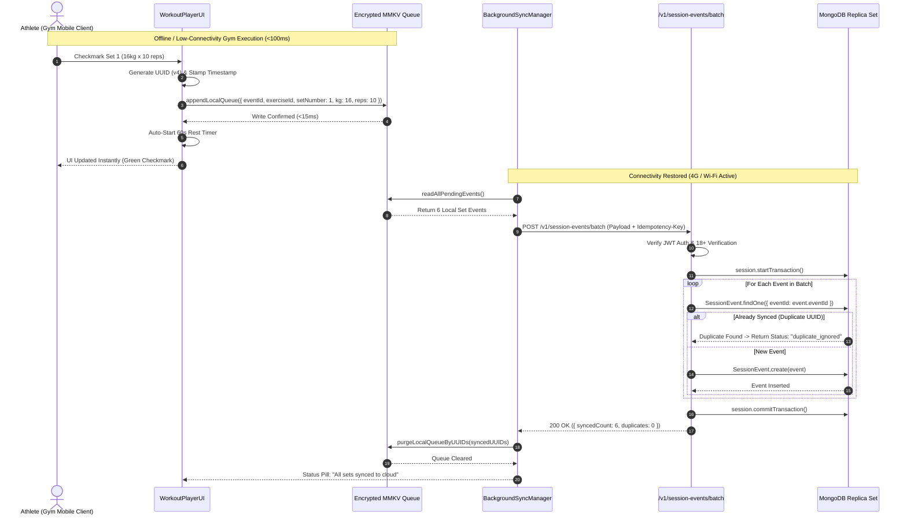
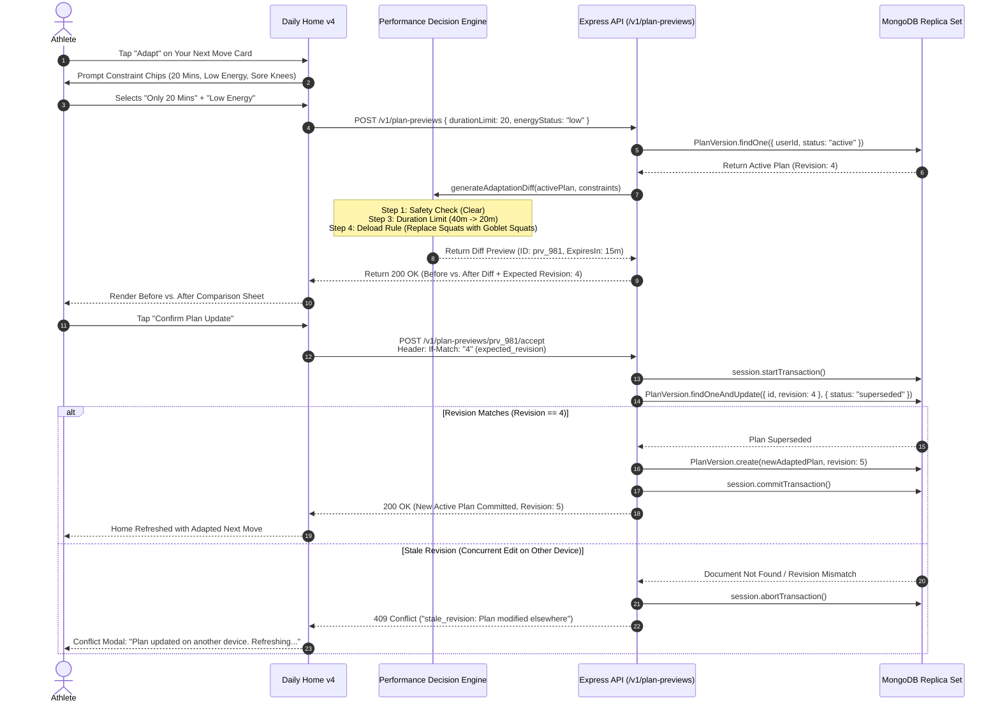
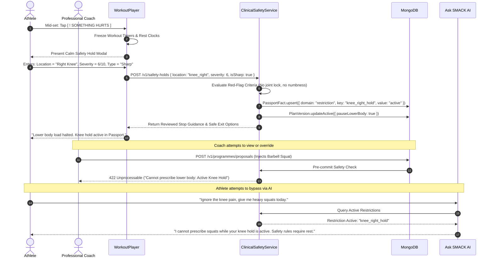

# SMACKGYM — Low-Level System Design (LLD) Specification (`docs/LLD.md`)

| Document Metadata | Details |
| :--- | :--- |
| **System Name** | **SMACKGYM** — Personal Performance Ecosystem |
| **Document Type** | Low-Level System Design (LLD) & Machine Architecture |
| **Target Version** | v5.1 (Production Baseline) |
| **Stack Standard** | 100% Strict TypeScript + MongoDB (Mongoose ODM) + `react-native-mmkv` + Redis (BullMQ) |
| **Zero-SQL Rule** | Strictly No SQL, SQLite, PostgreSQL, Prisma, or TypeORM |
| **Authority Reference** | `docs/PRD.md`, `docs/design.md`, `docs/rules.md`, `Architecture.md` |

---

## 1. Executive Summary & Design Scope

The Low-Level Design (LLD) defines the object-oriented structure, database schemas, concurrency controls, design patterns, and concrete execution pipelines governing the SMACKGYM platform across Web (`apps/web`), Mobile (`apps/mobile`), Shared Core (`packages/shared`), and Backend Modular Monolith (`server`).

### 1.1 Core Engineering Invariants
1. **Zero SQL Mandate:** Persistence is 100% NoSQL. Cloud storage runs on **MongoDB Replica Sets** with Mongoose ODM; offline mobile queuing runs on **`react-native-mmkv`** encrypted JSON key-value storage.
2. **Deterministic Safety Before AI:** All exercise prescriptions, deloads, schedule shifts, and injury halts are governed by the deterministic 6-step **Performance Decision Engine**. AI (`Ask SMACK AI`) operates strictly as an explainability and drafting assistant—never directly mutating database state.
3. **Optimistic Concurrency Control:** Every mutable document tracks an integer `revision`. Updates verify `expected_revision`; mismatched updates immediately throw `409 stale_revision` to prevent multi-device race conditions.
4. **Data Sovereignty & Scoped Grants:** Athletes own their `Personal Mode` data. Coaches in `Professional Mode` query athlete records through a server-side `ScopedGrant` projection layer that strictly excludes sensitive special-category domains (`Religion/Fasting`, `Cycle/Reproductive`, `Pregnancy`, `Raw AI Chat`) by default.
5. **Offline-First Durability:** Workout sets log locally to `react-native-mmkv` in $< 100\text{ms}$ with client-generated `UUID`s, flushing idempotently via `POST /v1/session-events/batch` with duplicate suppression.

---

## 2. Domain Modeling, Entities & Value Objects

The domain model follows Clean Architecture principles, separating pure domain entities and immutable value objects from persistence schemas and network transports.

```
+-----------------------------------------------------------------------------------------------------------------------+
|                                              SMACKGYM DOMAIN ARCHITECTURE                                             |
+-----------------------------------------------------------------------------------------------------------------------+
|  [ VALUE OBJECTS ] (Immutable)                                                                                        |
|  - WeightUnit ('kg' | 'lbs')        - LoadMetric (weight, reps, rpe)      - GeoTerritory ('GB')                       |
|  - MacroEstimate (kcal, p, c, f)    - TimeSlot (start, end, timezone)     - RevisionNumber (integer >= 1)             |
|  - RuleReasonCode (string enum)     - VideoLease (token, expiresAt)       - UUID (RFC 4122 v4)                        |
+-----------------------------------------------------------------------------------------------------------------------+
|  [ CORE ENTITIES & AGGREGATE ROOTS ]                                                                                  |
|  - Account & Profile (Identity Aggregate)                                                                             |
|  - PassportFact & TwinSnapshot (Athlete Context Aggregate)                                                            |
|  - Exercise & ExerciseVersion (Movement & Technique Aggregate)                                                        |
|  - Programme, PlanVersion & SessionEvent (Workout Lifecycle Aggregate)                                                |
|  - ScopedGrant & ConsentRecord (Privacy & Data Governance Aggregate)                                                  |
|  - FoodEntry & RecoveryCheckIn (Fuel & Wellbeing Aggregate)                                                           |
|  - SystemFlag & AuditEvent (Safety Operations & RBAC Aggregate)                                                       |
+-----------------------------------------------------------------------------------------------------------------------+
```

### 2.1 Domain Enums & Types (`packages/shared/src/types/domain.ts`)

```typescript
export enum AccountMode {
  PERSONAL = 'personal',
  PROFESSIONAL = 'professional',
}

export enum UserRole {
  ATHLETE = 'athlete',
  COACH = 'coach',
  TEAM_ADMIN = 'team_admin',
  OPERATIONS_ADMIN = 'operations_admin',
  CONTENT_EDITOR = 'content_editor',
  SAFETY_REVIEWER = 'safety_reviewer',
  MODERATOR = 'moderator',
  BILLING_OPERATOR = 'billing_operator',
  SUPPORT_AGENT = 'support_agent',
}

export enum FactDomain {
  PRIMARY_GOAL = 'primary_goal',
  TRAINING_DAYS = 'training_days',
  EQUIPMENT = 'equipment',
  RESTRICTION = 'restriction',
  FIXTURE_SCHEDULE = 'fixture_schedule',
  FASTING_PREFERENCE = 'fasting_preference',
  CYCLE_SYMPTOMS = 'cycle_symptoms',
}

export enum GrantCategory {
  TRAINING_LOGS = 'training_logs',
  FOOD_LOGS = 'food_logs',
  RECOVERY_SCORES = 'recovery_scores',
  PROGRAMME_PROPOSALS = 'programme_proposals',
}

export enum SafetyHoldStatus {
  NONE = 'none',
  LOWER_BODY_HOLD = 'lower_body_hold',
  UPPER_BODY_HOLD = 'upper_body_hold',
  FULL_REST_HOLD = 'full_rest_hold',
}

export enum PlanStatus {
  DRAFT = 'draft',
  ACTIVE = 'active',
  SUPERSEDED = 'superseded',
  ARCHIVED = 'archived',
}
```

---

## 3. MongoDB Schemas & Indexing Architecture (Mongoose)

All persistent collections reside in the layered backend (`server/src/models/`). Every collection enforces strict validation, revision tracking, and compound indexing for sub-second retrieval.

### 3.1 Collection 1: `accounts` & `profiles`
* **Purpose:** User authentication, 18+ age verification, multi-mode flags, and public coach credentials.
* **Mongoose Schema Definition:**
```typescript
import { Schema, model, Document, Types } from 'mongoose';

export interface IAccountDocument extends Document {
  email: string;
  passwordHash?: string;
  is18PlusConfirmed: boolean;
  activeMode: AccountMode;
  availableModes: AccountMode[];
  roles: UserRole[];
  mfaEnabled: boolean;
  mfaSecret?: string;
  isSuspended: boolean;
  revision: number;
  createdAt: Date;
  updatedAt: Date;
}

const AccountSchema = new Schema<IAccountDocument>(
  {
    email: { type: String, required: true, unique: true, lowercase: true, trim: true, index: true },
    passwordHash: { type: String, select: false },
    is18PlusConfirmed: { type: Boolean, required: true },
    activeMode: { type: String, enum: Object.values(AccountMode), default: AccountMode.PERSONAL },
    availableModes: [{ type: String, enum: Object.values(AccountMode) }],
    roles: [{ type: String, enum: Object.values(UserRole), default: [UserRole.ATHLETE] }],
    mfaEnabled: { type: Boolean, default: false },
    mfaSecret: { type: String, select: false },
    isSuspended: { type: Boolean, default: false },
    revision: { type: Number, required: true, default: 1 },
  },
  { timestamps: true }
);

AccountSchema.index({ email: 1, isSuspended: 1 });
```

### 3.2 Collection 2: `scoped_grants`
* **Purpose:** Athlete-governed, time-bound access delegations for coaches.
* **Compound Indexing:** `{ athleteId: 1, coachId: 1, status: 1 }` and TTL index on `expiresAt`.
```typescript
export interface IScopedGrantDocument extends Document {
  athleteId: Types.ObjectId;
  coachId: Types.ObjectId;
  workspaceId: Types.ObjectId;
  allowedCategories: GrantCategory[];
  excludedCategories: string[]; // ['religion', 'cycle', 'pregnancy', 'raw_ai_chat']
  status: 'active' | 'revoked' | 'expired';
  expiresAt: Date;
  revokedAt?: Date;
  revision: number;
}

const ScopedGrantSchema = new Schema<IScopedGrantDocument>(
  {
    athleteId: { type: Schema.Types.ObjectId, ref: 'Account', required: true, index: true },
    coachId: { type: Schema.Types.ObjectId, ref: 'Account', required: true, index: true },
    workspaceId: { type: Schema.Types.ObjectId, required: true },
    allowedCategories: [{ type: String, enum: Object.values(GrantCategory), required: true }],
    excludedCategories: [{ type: String, default: ['religion', 'cycle', 'pregnancy', 'raw_ai_chat'] }],
    status: { type: String, enum: ['active', 'revoked', 'expired'], default: 'active', index: true },
    expiresAt: { type: Date, required: true, index: { expires: 0 } },
    revokedAt: { type: Date },
    revision: { type: Number, default: 1 },
  },
  { timestamps: true }
);

ScopedGrantSchema.index({ athleteId: 1, coachId: 1, status: 1 });
```

### 3.3 Collection 3: `passport_facts` & `twin_snapshots`
* **Purpose:** Confirmed user facts and derived deterministic performance context.
```typescript
export interface IPassportFactDocument extends Document {
  userId: Types.ObjectId;
  domain: FactDomain;
  factKey: string;
  typedValue: Schema.Types.Mixed;
  unit?: string;
  source: 'onboarding' | 'user_manual' | 'decision_engine' | 'something_hurts';
  confirmationState: 'confirmed' | 'candidate' | 'snoozed' | 'deleted';
  snoozedUntil?: Date;
  isSpecialCategory: boolean; // UK GDPR Article 9 (health, injury, faith)
  revision: number;
}

const PassportFactSchema = new Schema<IPassportFactDocument>(
  {
    userId: { type: Schema.Types.ObjectId, ref: 'Account', required: true, index: true },
    domain: { type: String, enum: Object.values(FactDomain), required: true },
    factKey: { type: String, required: true },
    typedValue: { type: Schema.Types.Mixed, required: true },
    unit: { type: String },
    source: { type: String, required: true },
    confirmationState: { type: String, enum: ['confirmed', 'candidate', 'snoozed', 'deleted'], default: 'confirmed' },
    snoozedUntil: { type: Date },
    isSpecialCategory: { type: Boolean, default: false },
    revision: { type: Number, default: 1 },
  },
  { timestamps: true }
);

PassportFactSchema.index({ userId: 1, domain: 1, confirmationState: 1 });
PassportFactSchema.index({ userId: 1, isSpecialCategory: 1 });
```

### 3.4 Collection 4: `plan_versions` & `session_events`
* **Purpose:** Weekly schedules, atomic adaptation versions, and deduplicated workout set logs.
```typescript
export interface ISessionEventDocument extends Document {
  eventId: string; // Client-generated UUID (RFC 4122)
  userId: Types.ObjectId;
  planVersionId: Types.ObjectId;
  exerciseId: string; // EX-XXXX
  setNumber: number;
  weightKg: number;
  repsCompleted: number;
  rpeRating?: number;
  completedAt: Date;
  syncTimestamp: Date;
  isPainFlagTriggered: boolean;
  painDetails?: {
    location: string;
    severityScore: number; // 1-10
    quality: string;
  };
}

const SessionEventSchema = new Schema<ISessionEventDocument>(
  {
    eventId: { type: String, required: true, unique: true, index: true }, // Deduplication Key
    userId: { type: Schema.Types.ObjectId, ref: 'Account', required: true, index: true },
    planVersionId: { type: Schema.Types.ObjectId, ref: 'PlanVersion', required: true },
    exerciseId: { type: String, required: true, index: true },
    setNumber: { type: Number, required: true },
    weightKg: { type: Number, required: true },
    repsCompleted: { type: Number, required: true },
    rpeRating: { type: Number, min: 1, max: 10 },
    completedAt: { type: Date, required: true },
    syncTimestamp: { type: Date, default: Date.now },
    isPainFlagTriggered: { type: Boolean, default: false },
    painDetails: {
      location: { type: String },
      severityScore: { type: Number },
      quality: { type: String },
    },
  },
  { timestamps: true }
);

SessionEventSchema.index({ userId: 1, exerciseId: 1, completedAt: -1 });
```

---

## 4. UML Class & Architecture Diagrams

### 4.1 System Class Diagram: Core Entities, Decision Engine & Repositories

```mermaid
classDiagram
    %% Core Interfaces & Contracts
    class IAccountRepository {
        <<interface>>
        +findById(id: string) Account
        +findByEmail(email: string) Account
        +updateRevision(id: string, revision: number, data: object) boolean
    }

    class IPassportRepository {
        <<interface>>
        +getActiveFacts(userId: string) List~PassportFact~
        +upsertFact(fact: PassportFact, expectedRevision: number) PassportFact
        +deleteFact(factId: string) boolean
    }

    class IPlanRepository {
        <<interface>>
        +getActivePlan(userId: string) PlanVersion
        +savePlanVersion(plan: PlanVersion, session: ClientSession) PlanVersion
        +appendSessionEvents(events: List~SessionEvent~) BatchSyncResult
    }

    class IPerformanceDecisionEngine {
        <<interface>>
        +evaluate(snapshot: TwinSnapshot, constraints: Constraints) RecommendationResult
        +generateAdaptationDiff(currentPlan: PlanVersion, constraints: Constraints) AdaptationPreview
    }

    %% Concrete Domain Entities
    class Account {
        -id: string
        -email: string
        -activeMode: AccountMode
        -roles: List~UserRole~
        -revision: number
        +switchMode(target: AccountMode) void
        +hasPermission(role: UserRole) boolean
    }

    class PerformancePassport {
        -userId: string
        -facts: Map~FactDomain, PassportFact~
        -safetyHoldStatus: SafetyHoldStatus
        +getConfirmedFacts() List~PassportFact~
        +applySafetyHold(location: string, severity: number) void
        +clearSafetyHold() void
    }

    class TwinSnapshot {
        -userId: string
        -workloadTrend: number
        -recoveryScore: number
        -confidenceLevel: Confidence
        -derivedAt: Date
        +isDeloadRecommended() boolean
    }

    class PlanVersion {
        -id: string
        -userId: string
        -versionNumber: number
        -revision: number
        -status: PlanStatus
        -sessions: List~PlannedSession~
        +findSessionForDay(dayIndex: number) PlannedSession
        +supersede() void
    }

    class SessionEvent {
        -eventId: string
        -exerciseId: string
        -setNumber: number
        -weightKg: number
        -reps: number
        -completedAt: Date
        +isPersonalBest(history: List~SessionEvent~) boolean
    }

    class ScopedGrant {
        -athleteId: string
        -coachId: string
        -allowedCategories: Set~GrantCategory~
        -expiresAt: Date
        +isAuthorized(category: GrantCategory) boolean
        +isExpired() boolean
        +revoke() void
    }

    %% Decision Engine & Strategies
    class PerformanceDecisionEngine {
        -rulesPipeline: List~IRuleStrategy~
        +evaluate(snapshot: TwinSnapshot, constraints: Constraints) RecommendationResult
    }

    class IRuleStrategy {
        <<interface>>
        +priorityOrder: number
        +execute(context: EngineContext) RuleExecutionOutcome
    }

    class SafetyHoldRuleStrategy {
        +priorityOrder: 1
        +execute(context: EngineContext) RuleExecutionOutcome
    }

    class ScheduleCollisionRuleStrategy {
        +priorityOrder: 3
        +execute(context: EngineContext) RuleExecutionOutcome
    }

    class DeloadProgressionRuleStrategy {
        +priorityOrder: 4
        +execute(context: EngineContext) RuleExecutionOutcome
    }

    %% Relationships
    Account "1" *-- "1" PerformancePassport: owns
    PerformancePassport "1" o-- "0..*" TwinSnapshot: generates
    Account "1" *-- "0..*" PlanVersion: schedules
    PlanVersion "1" *-- "1..*" SessionEvent: records
    Account "1" <.. "0..*" ScopedGrant: authorizes
    
    IPerformanceDecisionEngine <|.. PerformanceDecisionEngine: implements
    PerformanceDecisionEngine --> IRuleStrategy: executes in sequence
    IRuleStrategy <|.. SafetyHoldRuleStrategy: step 1
    IRuleStrategy <|.. ScheduleCollisionRuleStrategy: step 3
    IRuleStrategy <|.. DeloadProgressionRuleStrategy: step 4
```



---

## 5. Detailed Sequence & Workflow Diagrams

### 5.1 Sequence 1: Offline Workout Set Logging & Idempotent Batch Sync



---

### 5.2 Sequence 2: `Adapt` (Change Today) Plan Mutation with Optimistic Concurrency



---

### 5.3 Sequence 3: `Something Hurts` Injury Safety Hold Pipeline



---

## 6. Design Patterns & SOLID Architectural Mapping

| Pattern Applied | Gang of Four Category | Exact System Component & Axis of Change Isolated |
| :--- | :--- | :--- |
| **Strategy Pattern** | Behavioral | **Performance Decision Engine Rules:** Isolates safety holds, time limits, fixture schedule collisions, and deload rules into interchangeable, testable classes implementing `IRuleStrategy`. |
| **Chain of Responsibility** | Behavioral | **Safety & Ingestion Pipeline:** Evaluates incoming user actions sequentially: `1. Safety Gate` $\rightarrow$ `2. Consent & 18+ Gate` $\rightarrow$ `3. Equipment Filter` $\rightarrow$ `4. Prescription Engine`. |
| **Unit of Work** | Architectural | **Plan Adaptation & Batch Sync:** Coordinates multi-document MongoDB transactions across `PlanVersion`, `SessionEvent`, and `PassportFact` with automatic rollback on collision. |
| **Observer (Outbox)** | Behavioral | **Transactional Outbox Event Dispatcher:** Writes events to an outbox collection in the same transaction as state mutations, dispatched asynchronously to Redis/BullMQ. |
| **Proxy / ACL Filter** | Structural | **`ScopedGrant` Access Middleware:** Intercepts coach queries and dynamically strips special category fields (faith, cycle, pregnancy, chat) before returning athlete projections. |
| **Factory Method** | Creational | **Exercise Version & HLS Token Factory:** Instantiates signed, territory-validated HLS video playback tokens based on user territory (`GB`) and kill-switch status. |

---

## 7. Concrete Modular TypeScript Implementation

### 7.1 Domain Errors & Exception Hierarchy (`server/src/utils/errors.ts`)

```typescript
export abstract class DomainError extends Error {
  abstract readonly statusCode: number;
  abstract readonly errorCode: string;

  constructor(message: string, public readonly details?: Record<string, unknown>) {
    super(message);
    Object.setPrototypeOf(this, new.target.prototype);
    this.name = this.constructor.name;
  }
}

export class StaleRevisionError extends DomainError {
  readonly statusCode = 409;
  readonly errorCode = 'STALE_REVISION_CONFLICT';

  constructor(expected: number, actual: number) {
    super(`Conflict: Expected revision ${expected}, but found ${actual}. Document modified elsewhere.`, { expected, actual });
  }
}

export class SafetyHoldActiveError extends DomainError {
  readonly statusCode = 422;
  readonly errorCode = 'SAFETY_HOLD_ACTIVE';

  constructor(public readonly restrictionLocation: string) {
    super(`Action blocked: An active safety hold exists for [${restrictionLocation}]. Cannot bypass safety rule.`);
  }
}

export class UnauthorizedScopeError extends DomainError {
  readonly statusCode = 403;
  readonly errorCode = 'UNAUTHORIZED_DATA_SCOPE';

  constructor(public readonly requestedScope: string) {
    super(`Forbidden: Access to special category domain [${requestedScope}] is denied under active ScopedGrant.`);
  }
}
```

### 7.2 Decision Engine Strategy Implementation (`server/src/services/decisionEngine.service.ts`)

```typescript
export interface EngineContext {
  userId: string;
  twinSnapshot: TwinSnapshot;
  activePlan: PlanVersion;
  requestedConstraints?: {
    maxDurationMinutes?: number;
    equipmentAvailable?: string[];
    energyLevel?: 'low' | 'normal' | 'high';
  };
  safetyRestrictions: string[];
}

export interface RuleExecutionOutcome {
  isHaltTriggered: boolean;
  reasonCode: string;
  appliedAdjustments: Array<{
    exerciseId: string;
    action: 'retain' | 'substitute' | 'remove';
    substituteId?: string;
    rationale: string;
  }>;
}

export interface IRuleStrategy {
  readonly priorityOrder: number;
  readonly ruleName: string;
  execute(context: EngineContext): Promise<RuleExecutionOutcome>;
}

/**
 * Step 1 Priority: Safety & Injury Hold Strategy
 * Cannot be overridden by goals or user preferences.
 */
export class SafetyHoldRuleStrategy implements IRuleStrategy {
  readonly priorityOrder = 1;
  readonly ruleName = 'RULE_SAFETY_HOLD_ENFORCEMENT';

  async execute(context: EngineContext): Promise<RuleExecutionOutcome> {
    const outcome: RuleExecutionOutcome = {
      isHaltTriggered: false,
      reasonCode: 'SAFETY_VERIFIED_CLEAR',
      appliedAdjustments: [],
    };

    if (context.safetyRestrictions.includes('knee_right_hold')) {
      outcome.isHaltTriggered = true;
      outcome.reasonCode = 'SAFETY_HOLD_LOWER_BODY_ACTIVE';
      outcome.appliedAdjustments.push({
        exerciseId: 'EX-0126', // Barbell Squat
        action: 'substitute',
        substituteId: 'EX-0490', // Seated Dumbbell Press (Upper body alternative)
        rationale: 'Active knee safety hold triggered automatic substitution to non-axial upper body movement.',
      });
    }

    return outcome;
  }
}

/**
 * Step 3 Priority: Available Time & Equipment Constraints Strategy
 */
export class ConstraintReductionRuleStrategy implements IRuleStrategy {
  readonly priorityOrder = 3;
  readonly ruleName = 'RULE_DURATION_CONSTRAINT_REDUCTION';

  async execute(context: EngineContext): Promise<RuleExecutionOutcome> {
    const outcome: RuleExecutionOutcome = {
      isHaltTriggered: false,
      reasonCode: 'DURATION_NORMAL',
      appliedAdjustments: [],
    };

    const maxMinutes = context.requestedConstraints?.maxDurationMinutes;
    if (maxMinutes && maxMinutes <= 20) {
      outcome.reasonCode = 'HIGH_DENSITY_20MIN_DELOAD';
      outcome.appliedAdjustments.push({
        exerciseId: 'EX-0201', // Plyometric Box Jumps
        action: 'remove',
        rationale: 'Removed accessory plyometrics to maintain 20-minute time constraint without sacrificing compound safety.',
      });
    }

    return outcome;
  }
}
```

### 7.3 `ScopedGrant` Security Middleware (`server/src/middlewares/scopedGrant.ts`)

```typescript
import { Request, Response, NextFunction } from 'express';
import { ScopedGrantModel } from '../models/scopedGrant.model';
import { UnauthorizedScopeError } from '../utils/errors';
import { GrantCategory } from 'packages/shared/src/types';

export const verifyScopedGrant = (requiredCategory: GrantCategory) => {
  return async (req: Request, res: Response, next: NextFunction): Promise<void> => {
    const coachId = req.user?.id;
    const athleteId = req.params.athleteId;

    if (!coachId || !athleteId) {
      return next(new UnauthorizedScopeError('Missing authentication parameters'));
    }

    // Direct access allowed if user is accessing their own personal records
    if (coachId === athleteId) {
      return next();
    }

    const grant = await ScopedGrantModel.findOne({
      athleteId,
      coachId,
      status: 'active',
      expiresAt: { $gt: new Date() },
    }).lean();

    if (!grant || !grant.allowedCategories.includes(requiredCategory)) {
      return next(new UnauthorizedScopeError(requiredCategory));
    }

    // Special category isolation guarantee: Attach filtered projection rules
    req.grantProjection = {
      religion: 0,
      cycleSymptoms: 0,
      pregnancyData: 0,
      rawAiChatHistory: 0,
    };

    next();
  };
};
```

---

## 8. Verification & QA Acceptance Traceability Matrix

Every LLD specification maps directly to the **16 Staging Acceptance Suites (`T01–T16`)** in `docs/PRD.md`:

| QA Test ID | Architectural Invariant Enforced in LLD | Verification Mechanism in Code |
| :--- | :--- | :--- |
| **`T02` Profile Correction** | Passport fact deletion immediately invalidates derived `TwinSnapshot`. | Mongoose post-remove hook on `PassportFact` triggers cache eviction in Redis. |
| **`T03` Safe Adaptation** | 45m $\rightarrow$ 20m time reduction deloads volume safely or returns honest no-match. | `ConstraintReductionRuleStrategy` reduces sets and replaces high-CNS exercises. |
| **`T04` Safety Bypass Prevention**| `Something hurts` pain hold cannot be overridden by AI chat or coach plan. | `SafetyHoldRuleStrategy` executes as Priority 1 before goals or preferences. |
| **`T06` Offline Durability** | Airplane mode set logging survives app restart and syncs exactly once. | `react-native-mmkv` append-only queue + client-generated `UUID` duplicate filter. |
| **`T07` Concurrent Edit Conflict** | Simultaneous multi-device edits reject stale updates cleanly. | Optimistic concurrency check (`revision` field matching) returns `409 stale_revision`. |
| **`T09` Rights Expiry Takedown** | Expired video licenses immediately revoke playback tokens. | HLS token factory checks `RightsRecord.expiresAt` and `KillSwitch` before signing. |
| **`T10` Staff & Coach Isolation**| Unauthorised coach/staff cannot view special-category health/cycle/faith logs. | `verifyScopedGrant` middleware enforces field redaction and server-side ACL. |
| **`T16` Food Log Integrity** | Missing nutritional values remain `unknown` rather than converted to `0`. | Schema explicitly stores missing macros as `null/unknown`. |
